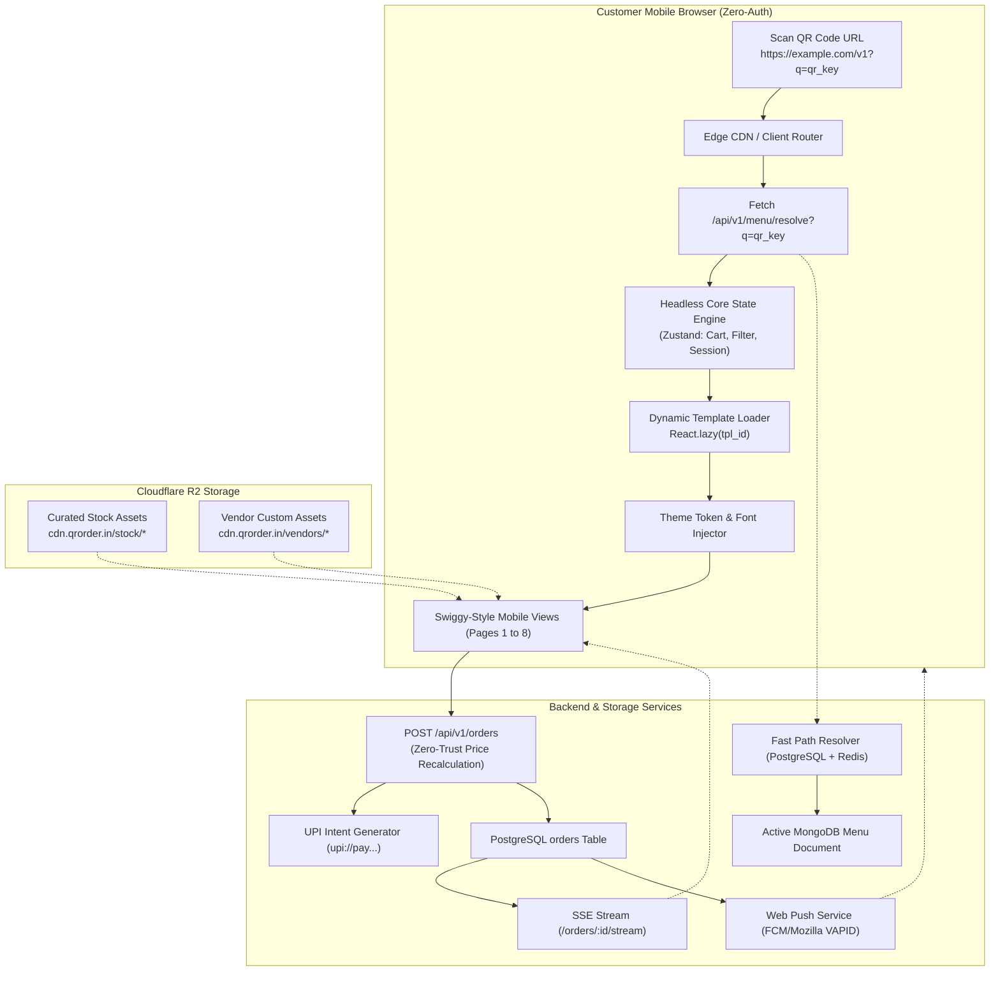

# ============================================================================
# QR-ORDER SAAS: CLIENT-FACING DYNAMIC WEB APPLICATION REQUIREMENTS (CLIENT-FRM.md)
# DYNAMIC MULTI-TEMPLATE ZERO-AUTH QR MENU, CART, UPI INTENT & ORDER TRACKING
# ============================================================================
# Version: 1.0.0 (Production Release)
# Target Architecture: Single-Page Application (SPA) / React 19 / TypeScript / Tailwind CSS / Custom CSS
# Communication Protocol: REST API (JSON) + Server-Sent Events (SSE) + Web Push API (RFC 8030)
# CDN & Media Storage: Cloudflare CDN + Cloudflare R2 (Dual-Tier Curated Stock & Custom Assets)
# Design Style: Default Modern High-Conversion Swiggy-Inspired Mobile-Centric UX
# Audience: Frontend Engineers, System Architects, Mobile UX Designers, QA Engineers
# ============================================================================

---

## TABLE OF CONTENTS
1. [Product Requirements Document (PRD)](#1-product-requirements-document-prd)
2. [Technical Requirements Document (TRD) & System Architecture](#2-technical-requirements-document-trd--system-architecture)
3. [Cloudflare R2 Media Asset System (Curated Stock vs Custom)](#3-cloudflare-r2-media-asset-system-curated-stock-vs-custom)
4. [Multi-Template Dynamic Engine (10+ Templates at Scale)](#4-multi-template-dynamic-engine-10-templates-at-scale)
5. [Exhaustive Page-by-Page Specifications (8 Core Views)](#5-exhaustive-page-by-page-specifications-8-core-views)
   - [View 1: QR Bootstrap & Fast-Path Resolver](#view-1-qr-bootstrap--fast-path-resolver)
   - [View 2: Swiggy-Inspired Storefront & Menu Browser](#view-2-swiggy-inspired-storefront--menu-browser)
   - [View 3: Customization & Variant Bottom Sheet](#view-3-customization--variant-bottom-sheet)
   - [View 4: Cart & Bill Breakdown Summary](#view-4-cart--bill-breakdown-summary)
   - [View 5: Checkout & UPI Intent Gateway](#view-5-checkout--upi-intent-gateway)
   - [View 6: Live Order Tracker & Ref-Token Screen](#view-6-live-order-tracker--ref-token-screen)
   - [View 7: Web Push Notification & Pickup Handover](#view-7-web-push-notification--pickup-handover)
   - [View 8: Waiter Call & Floor Service Modal](#view-8-waiter-call--floor-service-modal)
6. [Backend API Contracts Consumed by Client](#6-backend-api-contracts-consumed-by-client)
7. [Mobile-Centric UI/UX Constraints & Responsiveness](#7-mobile-centric-uiux-constraints--responsiveness)
8. [Performance, Caching & Bundle Optimization](#8-performance-caching--bundle-optimization)
9. [Zero-Trust Security & Payment Integrity Checks](#9-zero-trust-security--payment-integrity-checks)
10. [End-to-End Master Implementation Prompt for Frontend Agents](#10-end-to-end-master-implementation-prompt-for-frontend-agents)

---

## 1. PRODUCT REQUIREMENTS DOCUMENT (PRD)

### 1.1 Executive Product Vision
The Client-Facing Dynamic QR Web Application provides a frictionless, instant-loading digital dining and ordering interface for customers scanning QR codes across restaurants, cafes, food trucks, QSR stalls, and remote delivery spots (e.g. gyms, co-working lounges).

The core philosophy of this customer application is:
1. **Zero Authentication Friction**: No app downloads, no mandatory OTP logins, no passwords. A customer scans the physical QR code and is looking at an interactive menu within **under 1.5 seconds**.
2. **Dynamic Multi-Template Experience**: A single universal client codebase dynamically morphs into 10+ completely distinct templates, layouts, colors, and typography sets based on the vendor's active configuration in MongoDB (`design_config.template_id`).
3. **Frictionless Payments via UPI Web Intent**: Native mobile browser redirection to UPI apps (Google Pay, PhonePe, Paytm, CRED, BHIM) allows seamless 1-tap checkout.
4. **End-to-End Fulfilment Visibility**: Real-time status tracker via Server-Sent Events (SSE) and native device Web Push notifications so diners know precisely when their food is cooking or ready at the pickup counter.

### 1.2 Customer Personas & Fulfillment Journeys

```
+--------------------------------------------------------------------------------------------------+
|                                      CUSTOMER FULFILLMENT MODES                                  |
+-----------------------------------+-----------------------------------+--------------------------+
| 1. DINE-IN (WAITER_SERVING)       | 2. QSR / KIOSK (SELF_SERVING)     | 3. REMOTE DELIVERY SPOT  |
+-----------------------------------+-----------------------------------+--------------------------+
| - Customer scans Table QR (T-04)  | - Customer scans Counter/Van QR   | - Customer scans QR in   |
| - Browses menu, adds to cart      | - Selects meal, pays via UPI      |   Gym / Co-working lounge|
| - Pays upfront (PREPAID) or       | - Gets daily token e.g. #7A29     | - Enters delivery note   |
|   requests bill later (POSTPAID)  | - Receives WebPush alert when     | - Pays via UPI Intent    |
| - Chef cooks -> Waiter serves     |   Chef marks READY                | - Runner delivers spot   |
| - "Call Waiter" button active     | - Quotes #7A29 at pickup counter  | - Verifies token & serves|
+-----------------------------------+-----------------------------------+--------------------------+
```

### 1.3 Key Functional Objectives & KPIs
- **Initial First Contentful Paint (FCP)**: $< 1.0\text{s}$ on 4G cellular networks.
- **Time to Interactive (TTI)**: $< 1.5\text{s}$.
- **Cart Abandonment Target**: $< 12\%$ achieved via zero-login one-click checkout.
- **Lighthouse Performance Score**: $\ge 95$ on mobile audit.

---

## 2. TECHNICAL REQUIREMENTS DOCUMENT (TRD) & SYSTEM ARCHITECTURE

### 2.1 Technology Stack Matrix
- **Framework**: React 19 (SPA mode) with TypeScript strict mode.
- **Build Tool**: Vite 6+ with dynamic ES module code-splitting.
- **Styling Architecture**: Tailwind CSS v3/v4 + CSS Custom Properties (Theme Tokens) + Custom CSS micro-animations.
- **State Management**: Zustand (for ultra-lightweight, zero-boilerplate cart, session, and active order persistence).
- **Icons**: Lucide-React (tree-shakeable vector icons).
- **Real-Time Data**: Native `EventSource` (Server-Sent Events) with exponential backoff re-connection.
- **Web Push Engine**: Service Worker (Workbox / Native) utilizing standard VAPID Web Push (RFC 8030).
- **HTTP Transport**: Fetch API wrapper with type-safe schemas, timeout handling, and idempotency headers.

### 2.2 System Architecture Diagram



---

## 3. CLOUDFLARE R2 MEDIA ASSET SYSTEM (CURATED STOCK VS CUSTOM)

### 3.1 Dual-Tier Asset Architecture
To eliminate duplicate storage costs (e.g., hundreds of cafes uploading identical generic images of burgers, cappuccinos, or momos), images are split into two decoupled layers:

| Asset Dimension | Tier 1: Global Curated Stock Library | Tier 2: Vendor Custom Uploads |
| :--- | :--- | :--- |
| **Storage Base URL** | `https://cdn.qrorder.in/stock/` | `https://cdn.qrorder.in/vendors/{vendor_id}/` |
| **Origin Storage** | Cloudflare R2 bucket: `qr-assets-global` | Cloudflare R2 bucket: `qr-assets-tenants` |
| **Asset Formats** | Pre-optimized WebP (`thumb_120`, `card_400`, `hero_800`) | Cloudflare Worker WebP conversion pipeline |
| **Ownership** | Platform managed, immutable, deduplicated | Vendor-owned, scoped, deletable |
| **Selection Flow** | Vendor clicks "Choose Image" $\rightarrow$ Stock Modal Picker | Vendor clicks "Upload My Photo" $\rightarrow$ Direct S3 Pre-signed URL |

### 3.2 MongoDB Menu Item Representation
The item schema accommodates both seamlessly:
```json
{
  "id": "itm_crispy_chicken_burger",
  "name": "Crunchmaster Chicken Burger",
  "images": [
    {
      "url": "https://cdn.qrorder.in/stock/items/burger_crunchy_chicken.webp",
      "alt": "Crispy fried chicken breast burger",
      "is_stock": true,
      "stock_id": "stk_burger_chicken_04"
    }
  ]
}
```

### 3.3 Dashboard Stock Picker Component Specification
When the vendor manages items in their dashboard:
1. Vendor clicks the image placeholder.
2. A fast popover displays:
   - Search input (queries item tags: `"biryani"`, `"pizza"`, `"shake"`).
   - Diet category filter tabs (`VEG`, `NON_VEG`, `DRINKS`, `DESSERTS`).
   - A grid of pre-stored 120x120 thumbnails loaded from `GET /api/v1/media/stock-assets`.
3. Selecting an image writes the verified Cloudflare R2 stock URL into the MongoDB document without duplicating bytes.

---

## 4. MULTI-TEMPLATE DYNAMIC ENGINE (10+ TEMPLATES AT SCALE)

### 4.1 Bundle Splitting Architecture
To prevent the client application from bundling all 10+ full website templates into a single monolithic bundle:
- **Separation of Concerns**: The Business Logic (cart, order calculation, variants, addons, filters, checkout) lives in `@/core`.
- **Presentation Packages**: Each template is a self-contained directory under `@/templates/{template_id}` containing layout views, card layouts, and CSS theme definitions.
- **Lazy Code-Splitting**: The router uses `React.lazy()` with Vite dynamic imports. Only the chunk requested by `design_config.template_id` is fetched over the network.

```
src/
├── core/                                 # 100% Shared Business Logic & Hooks
│   ├── hooks/
│   │   ├── useMenu.ts                    # Search, category scroll, dietary filters
│   │   ├── useCart.ts                    # Variant & add-on calculations, min/max guards
│   │   ├── useCheckout.ts                # UPI intent link generator, idempotency
│   │   ├── useOrderStatus.ts             # SSE stream listener & state transitions
│   │   └── useWebPush.ts                 # Service worker registration & VAPID token
│   ├── store/
│   │   ├── cartStore.ts                  # Zustand cart store with localStorage sync
│   │   └── sessionStore.ts               # Booth, vendor & ref_token persistence
│   └── types/
│       ├── menu.types.ts                 # Typed against mongo-menu-document.json
│       └── order.types.ts                # Typed against postgres-schema.sql
│
├── templates/                            # 10+ Independent Template Packages
│   ├── tpl_swiggy_modern/ (Default)      # Swiggy-like high-conversion orange/neutral theme
│   │   ├── components/
│   │   │   ├── Header.tsx                # Brand banner with veg/non-veg switch & search
│   │   │   ├── CategoryNav.tsx           # Sticky horizontal pills with active indicator
│   │   │   ├── MenuItemCard.tsx          # Swiggy-style horizontal food item card
│   │   │   └── FloatingCartBar.tsx       # Bottom bar showing item count & bill preview
│   │   ├── index.tsx                     # Master template layout
│   │   └── styles.css                    # Scoped styling rules
│   ├── tpl_editorial/                    # Fine dining layout with serif fonts & dark green
│   ├── tpl_street_bistro/                # Casual cafe layout with bold chips
│   ├── tpl_cyber_dark/                   # Dark mode neon lounge theme
│   └── registry.ts                       # Lazy dynamic import dictionary
│
├── theme/
│   └── ThemeProvider.tsx                 # Dynamically injects colors & Google fonts
└── App.tsx                               # Bootstrapper & route switcher
```

### 4.2 Dynamic Color & Font Injection
`ThemeProvider.tsx` reads `design_config` from the fetched MongoDB menu document and applies CSS variables to `:root`:

```ts
// Injects dynamic palette into document root
document.documentElement.style.setProperty('--color-primary', menuData.design_config.colors.primary);
document.documentElement.style.setProperty('--color-secondary', menuData.design_config.colors.secondary);
document.documentElement.style.setProperty('--color-accent', menuData.design_config.colors.accent);
document.documentElement.style.setProperty('--color-bg', menuData.design_config.colors.background);
document.documentElement.style.setProperty('--color-surface', menuData.design_config.colors.surface);
document.documentElement.style.setProperty('--color-text', menuData.design_config.colors.text);
document.documentElement.style.setProperty('--color-muted', menuData.design_config.colors.text_muted);
```

**Dynamic Font Loading Pipeline**:
The provider constructs the Google Fonts link dynamically using `design_config.fonts.heading` and `body`:
```ts
const headingFont = menuData.design_config.fonts.heading.replace('_', '+');
const bodyFont = menuData.design_config.fonts.body.replace('_', '+');
const fontUrl = `https://fonts.googleapis.com/css2?family=${headingFont}:wght@600;700&family=${bodyFont}:wght@400;500;600&display=swap`;
// Dynamically appends <link rel="stylesheet"> to document.head
```

---

## 5. EXHAUSTIVE PAGE-BY-PAGE SPECIFICATIONS (8 CORE VIEWS)

### View 1: QR Bootstrap & Fast-Path Resolver
- **Route**: `/v1?q=:qr_key`
- **Purpose**: Validates the physical QR scan, verifies operating hours, resolves vendor and table booth details, loads the menu, and loads the active template.
- **UI Components**:
  - Pulsing branded skeleton loader with animated cutlery icon.
  - Offline / Invalid QR error modal if `qr_key` is expired or unrecognized.
  - Closed Store Banner if current time is outside `[opening_time, closing_time]`.
- **State Actions**:
  - Extracts `q` query parameter.
  - Invokes `GET /api/v1/menu/resolve?q=:qr_key`.
  - Checks if an active uncompleted order exists in `localStorage` (`active_order_id`). If found, redirects directly to **View 6 (Live Order Tracker)**.

---

### View 2: Swiggy-Inspired Storefront & Menu Browser
- **Purpose**: Primary customer ordering view. Optimized for rapid single-handed mobile navigation.
- **UI Structure & Components**:

```
+-------------------------------------------------------------+
| [Vendor Logo]  Chai Break Cafe & Lounge       [Table #04]  |
| ★ 4.4 (500+ reviews) • 20 mins prep • FSSAI Lic #12024001   |
+-------------------------------------------------------------+
| [ 🔍 Search dishes, biryani, burgers... ]                   |
+-------------------------------------------------------------+
| [🟢 Veg Only]  [🔴 Non-Veg]  [🌶️ Spicy]  [⭐ Bestseller]     |  <- Filter Pills
+-------------------------------------------------------------+
| (Biryani Special)  (Burgers)  (Beverages)  (Desserts)       |  <- Sticky Category Bar
+-------------------------------------------------------------+
| DUM BIRYANI SPECIAL (4 items)                               |
|                                                             |
| [🟢] Awadhi Chicken Dum Biryani              +------------+ |
| ₹189                                         |   [Image]  | |
| Tender chicken dum cooked with basmati rice. |   +------+ | |
| Customisable                                 |   | ADD+ | | |
|                                              |   +------+ | |
|                                              +------------+ |
| ----------------------------------------------------------- |
| [🟢] Hyderabadi Paneer Subz Biryani          +------------+ |
| ₹169                                         |   [Image]  | |
| Rich marinated paneer cubes with saffron.    |   +------+ | |
| Customisable                                 |   | ADD+ | | |
|                                              |   +------+ | |
|                                              +------------+ |
+-------------------------------------------------------------+
| [ 🛒 2 Items | ₹388 ]                  [ View Cart ➔ ]      |  <- Sticky Floating Bar
+-------------------------------------------------------------+
```

- **Interactive Behaviors**:
  - **Sticky Category Bar**: Uses native `IntersectionObserver` to highlight the category pill corresponding to the section currently in the viewport. Clicking a pill smooth-scrolls to the section.
  - **Veg / Non-Veg Switch**: Filters items instantly with zero network requests.
  - **Floating Cart Bar**: Slides up from the bottom with a spring animation (`translate-y-0`) as soon as `cart.items.length > 0`. Shows total items count and running total in Rupees.

---

### View 3: Customization & Variant Bottom Sheet
- **Trigger**: Customer clicks "ADD+" on an item with `pricing_type: "VARIANT"` or non-empty `addon_groups`.
- **UI Structure**:
  - Draggable modal bottom sheet with backdrop blur.
  - Header with item name, dietary icon, and base price.
  - **Variant Group (Single Choice - Radio Cards)**:
    - Lists variants (e.g., Half Plate ₹189 vs Full Plate ₹299).
    - Default variant pre-selected.
  - **Addon Groups (Multi-Choice - Checkboxes)**:
    - Validates `min_selection` and `max_selection`.
    - Shows tags like `Required (Choose 1)` or `Optional (Up to 3)`.
    - Price add-on badges: `+₹25`, `+₹35`.
  - **Special Cooking Note**:
    - Expandable text input: *"e.g. Make it extra spicy, no onions"*.
  - **Sticky Bottom Action**:
    - Live Price Counter: Dynamically recalculates total: $\text{variant price} + \sum \text{selected addons}$.
    - "Add Item ₹214" CTA button (Disabled if `min_selection` constraints are not satisfied).

---

### View 4: Cart & Bill Breakdown Summary
- **Route**: Modal Drawer or `/cart`
- **UI Structure**:
  - **Header**: "Your Cart" with Vendor Name & Table/Booth indicator.
  - **Item List**:
    - Item name, selected variant, selected add-ons chip tags.
    - Quantity stepper control: `[ - ] [ 2 ] [ + ]`. Decrementing to 0 prompts confirmation or deletes.
    - Line item price in `₹`.
  - **Cooking Instructions & Cutlery**:
    - Toggle: *"Don't send plastic cutlery (Eco-friendly)"*.
    - General order note input.
  - **Bill Summary Card**:
    - Item Subtotal: `₹388.00`
    - Taxes (CGST 2.5% + SGST 2.5% based on `tax_rate_percent`): `₹19.40`
    - Service Charge (if `service_charge_percent > 0`): `₹0.00`
    - Optional Delivery Tip chips: `[₹10] [₹20] [₹50] [Custom]`.
    - **Grand Total Payable**: `₹407.40`
  - **Customer Information Section**:
    - Customer Name (optional / lightweight for greeting).
    - Mobile Phone Number (10 digits, for digital receipt via WhatsApp/SMS).
  - **CTA Button**:
    - For `PREPAID`: "Proceed to Pay ₹407" (Launches UPI Intent).
    - For `POSTPAID`: "Confirm Order (Pay After Eating)".

---

### View 5: Checkout & UPI Intent Gateway
- **Purpose**: Direct mobile app redirection to user's installed UPI apps.
- **Workflow & UI States**:
  1. Customer taps "Proceed to Pay".
  2. The app issues `POST /api/v1/orders` with an idempotency key.
  3. Backend generates order, computes zero-trust pricing, assigns daily `order_no` and `ref_token`, and returns the NPCI UPI string:
     ```
     upi://pay?pa=chaibreak@icici&pn=ChaiBreakPatia&tr=ord_8kL2m9Xp1Q&am=407.40&cu=INR&tn=Order_7A29
     ```
  4. **Mobile Web Redirection**:
     - The app triggers the UPI URI. The OS opens the app picker (Google Pay, PhonePe, Paytm, CRED).
     - Customer approves payment in their bank app.
     - Customer switches back to the browser tab.
  5. **Desktop / Laptop Fallback**:
     - If user is browsing on a desktop browser, renders a dynamic SVG QR code on the modal screen for the user to scan with their mobile phone.
  6. **Reconciliation Spinner**:
     - Shows an animated pulse: *"Verifying payment with bank..."*
     - Listens to SSE event or polls `/orders/:id` until `payment_status: PAID`.
     - Automatically transitions to View 6 upon confirmation.

---

### View 6: Live Order Tracker & Ref-Token Screen
- **Route**: `/orders/:order_id?token=:ref_token`
- **Purpose**: The post-order dashboard for the customer while seated or waiting.
- **UI Structure**:

```
+-------------------------------------------------------------+
|                   CHAI BREAK CAFE & LOUNGE                  |
|                        ORDER PLACED                         |
+-------------------------------------------------------------+
|                                                             |
|                    TOKEN NUMBER:  #7A29                     |
|                      Order #42 • Table 04                   |
|                                                             |
+-------------------------------------------------------------+
|                                                             |
|   [✓] PLACED  ===> [✓] ACCEPTED ===> [ ] PREPARING ===> [ ] READY
|                                                             |
|   Estimated Preparation Time: ~15-20 Mins                   |
|                                                             |
+-------------------------------------------------------------+
| 🔔 GET NOTIFIED WHEN READY                                   |
| [ Enable Push Notification ]  <- One-tap permission button  |
+-------------------------------------------------------------+
| ORDER SUMMARY                                               |
| • 2x Awadhi Chicken Dum Biryani (Full)             ₹598.00  |
| • 1x Masala Lemonade (300ml)                        ₹85.00  |
| Total Paid (UPI): ₹683.00                                   |
+-------------------------------------------------------------+
| [ Cancel Order ] (Only active while INITIATED)              |
| [ Need Help? Call Waiter ]                                  |
+-------------------------------------------------------------+
```

- **Interactive Behaviors**:
  - SSE real-time stream dynamically steps the status badge forward without requiring page reload.
  - If status is `INITIATED`, a "Cancel Order" button is visible. Once status advances to `ACCEPTED`, the cancel button is hidden.

---

### View 7: Web Push Notification & Pickup Handover
- **Purpose**: Critical for `SELF_SERVING` counters (Food courts, Food vans, Takeaway).
- **Workflow**:
  1. Customer opts in via the "Enable Notification" prompt on View 6.
  2. The service worker subscribes to the browser's PushManager with the platform's VAPID Public Key.
  3. The subscription payload (`endpoint`, `p256dh`, `auth`) is registered with the backend.
  4. When the chef marks the order `READY` on the kitchen dashboard, the backend fires an RFC 8030 push message:
     ```json
     {
       "title": "Order #42 is Ready! 🍽️",
       "body": "Please collect your order at Counter A quoting token: 7A29.",
       "icon": "/icons/icon-192.png",
       "badge": "/icons/badge-72.png",
       "data": { "order_id": "ord_8kL2m9Xp1Q", "ref_token": "7A29" }
     }
     ```
  5. The customer's mobile device buzzes and displays the notification even if the browser tab is sleeping or in the background.
  6. Customer presents token `#7A29` to the staff. Staff verifies the token, marks the order `SERVED`, and the screen displays a completed receipt.

---

### View 8: Waiter Call & Floor Service Modal
- **Trigger**: Customer clicks "Call Waiter" floating icon or footer link.
- **UI Structure**:
  - Quick option chips:
    - 🔔 *Call Waiter to Table*
    - 💧 *Request Water Bottle / Glasses*
    - 🥢 *Request Extra Cutlery / Tissues*
    - 🧾 *Request Printed Bill*
  - Optional custom message input.
  - "Send Request" button $\rightarrow$ calls `POST /api/v1/service-requests`.
  - Toast confirmation: *"Staff has been notified. Someone will be at your table shortly."*

---

## 6. BACKEND API CONTRACTS CONSUMED BY CLIENT

### 6.1 Fast-Path Menu & Booth Resolution
- **Endpoint**: `GET /api/v1/menu/resolve`
- **Query Parameters**:
  - `q`: Physical QR code key (e.g. `qr_joaisjdfkasjdflj`).
- **Response Status**: `200 OK`

```json
{
  "success": true,
  "data": {
    "booth": {
      "id": "bth_9mK3xP1L8wZ4q7J2",
      "label": "Table 04",
      "zone": "Indoor AC",
      "seats": 4,
      "serving_model": "WAITER_SERVING"
    },
    "vendor": {
      "id": "vnd_7kJ2n9Xm4Pq1L8wZ",
      "name": "Chai Break Café & Lounge",
      "business_type": "CAFE",
      "slug": "chai-break-patia",
      "accept_order_type": "PREPAID",
      "order_confirmation_model": "MANUAL",
      "currency": "INR",
      "currency_symbol": "₹",
      "is_open": true,
      "opening_time": "09:00:00",
      "closing_time": "22:00:00"
    },
    "menu": {
      "menu_id": "menu_main_v1",
      "design_config": {
        "template_id": "tpl_swiggy_modern",
        "colors": {
          "primary": "#FC8019",
          "secondary": "#282C3F",
          "accent": "#60B244",
          "background": "#FFFFFF",
          "surface": "#F2F2F2",
          "text": "#1A1A1A",
          "text_muted": "#7E808C"
        },
        "fonts": {
          "heading": "inter",
          "body": "inter"
        },
        "options": {
          "show_hero_banner": true,
          "card_layout": "horizontal"
        }
      },
      "settings": {
        "ordering_enabled": true,
        "waiter_call_enabled": true,
        "show_search_bar": true,
        "show_diet_filter": true,
        "tax_rate_percent": 5.0,
        "service_charge_percent": 0.0,
        "estimated_prep_time_minutes": 20
      },
      "sections": [
        {
          "id": "sec_food_kitchen",
          "name": "Food & Kitchen",
          "sort_order": 1,
          "categories": [
            {
              "id": "cat_biryani",
              "name": "Dum Biryani Special",
              "items": [
                {
                  "id": "itm_chk_dum_biryani",
                  "name": "Awadhi Chicken Dum Biryani",
                  "description": "Slow dum-cooked basmati layered with tender chicken.",
                  "diet_type": "NON_VEG",
                  "spice_level": 2,
                  "images": [
                    {
                      "url": "https://cdn.qrorder.in/stock/items/biryani_chicken.webp",
                      "alt": "Chicken Dum Biryani Handi"
                    }
                  ],
                  "pricing_type": "VARIANT",
                  "base_price_paise": 18900,
                  "variants": [
                    { "id": "var_chk_half", "name": "Half Plate", "price_paise": 18900, "in_stock": true },
                    { "id": "var_chk_full", "name": "Full Plate", "price_paise": 29900, "in_stock": true }
                  ],
                  "addon_groups": [
                    {
                      "id": "grp_biryani_sides",
                      "title": "Add-ons & Extras",
                      "is_required": false,
                      "min_selection": 0,
                      "max_selection": 3,
                      "options": [
                        { "id": "opt_extra_raita", "name": "Extra Burani Raita", "price_paise": 2500, "in_stock": true }
                      ]
                    }
                  ],
                  "tags": ["BESTSELLER"],
                  "in_stock": true,
                  "is_visible": true
                }
              ]
            }
          ]
        }
      ]
    }
  }
}
```

---

### 6.2 Order Placement API
- **Endpoint**: `POST /api/v1/orders`
- **Headers**:
  - `Content-Type: application/json`
  - `X-Idempotency-Key: idemp_550e8400-e29b-41d4-a716-446655440000`
- **Request Payload**:

```json
{
  "qr_key": "qr_joaisjdfkasjdflj",
  "idempotency_key": "idemp_550e8400-e29b-41d4-a716-446655440000",
  "customer_name": "Rohan Das",
  "customer_phone": "+919876543210",
  "customer_note": "Make it extra spicy please",
  "payment_method": "UPI",
  "web_notif_config": {
    "endpoint": "https://fcm.googleapis.com/fcm/send/f_xyz...",
    "keys": {
      "p256dh": "BNcRdre123...",
      "auth": "tB3vyG456..."
    }
  },
  "items": [
    {
      "item_id": "itm_chk_dum_biryani",
      "variant_id": "var_chk_full",
      "quantity": 1,
      "customizations": [
        { "group_id": "grp_biryani_sides", "option_id": "opt_extra_raita" }
      ]
    }
  ]
}
```

- **Response Payload (`201 Created`)**:

```json
{
  "success": true,
  "message": "Order initiated successfully. Please complete payment.",
  "data": {
    "order_id": "ord_8kL2m9Xp1Q",
    "order_no": 42,
    "ref_token": "7A29",
    "status": "INITIATED",
    "payment_status": "PENDING",
    "total_paise": 32400,
    "currency": "INR",
    "booth_label": "Table 04",
    "serving_model": "WAITER_SERVING",
    "upi_intent_uri": "upi://pay?pa=chaibreak@icici&pn=ChaiBreakPatia&tr=ord_8kL2m9Xp1Q&am=324.00&cu=INR&tn=Order_7A29"
  }
}
```

---

### 6.3 Real-Time Order Stream (Server-Sent Events)
- **Endpoint**: `GET /api/v1/orders/:id/stream?token=:ref_token`
- **Protocol**: `text/event-stream`
- **Server Events**:
  - `ORDER_STATUS_UPDATE`: `{ "order_id": "ord_8kL2m9Xp1Q", "status": "ACCEPTED", "payment_status": "PAID" }`
  - `ORDER_PREPARING`: `{ "status": "PREPARING", "estimated_mins": 15 }`
  - `ORDER_READY`: `{ "status": "READY", "message": "Order is ready for pickup!" }`
  - `ORDER_SERVED`: `{ "status": "SERVED", "completed_at": "2026-10-06T19:35:00Z" }`

---

### 6.4 Customer Order Cancellation
- **Endpoint**: `POST /api/v1/orders/:id/cancel`
- **Request Payload**:
  ```json
  {
    "ref_token": "7A29",
    "reason": "Ordered wrong variant by accident"
  }
  ```
- **Rules**: Permitted strictly when `status == 'INITIATED'`.

---

### 6.5 Floor Assistance / Service Request
- **Endpoint**: `POST /api/v1/service-requests`
- **Request Payload**:
  ```json
  {
    "qr_key": "qr_joaisjdfkasjdflj",
    "type": "CALL_WAITER",
    "custom_note": "Need extra water glasses"
  }
  ```
- **Response**: `200 OK` `{ "success": true, "message": "Waiter notified" }`

---

## 7. MOBILE-CENTRIC UI/UX CONSTRAINTS & RESPONSIVENESS

### 7.1 Viewport & Physical Constraints
- **Safe Area Insets**:
  The bottom navigation, sticky cart bar, and bottom drawers must incorporate native iOS/Android safe area padding:
  ```css
  padding-bottom: env(safe-area-inset-bottom, 16px);
  padding-top: env(safe-area-inset-top, 0px);
  ```
- **Thumb-Zone Optimization**:
  All primary action targets ("ADD+", "View Cart", "Proceed to Pay", "Quantity steppers") must be located within the bottom 40% of the mobile screen.
- **Minimum Touch Target**:
  Every clickable button or chip must have a hit area of at least **$48 \times 48\text{px}$** to eliminate accidental clicks.
- **Overscroll Behavior**:
  Prevent iOS bouncing on full-screen drawers:
  ```css
  overscroll-behavior-y: contain;
  -webkit-overflow-scrolling: touch;
  ```

### 7.2 Micro-Interactions & Swiggy-Style Motion
1. **Quantity Stepper Transition**: When "ADD+" is clicked, the button morphs smoothly into `[-] [ 1 ] [+]` with a spring bounce (`cubic-bezier(0.175, 0.885, 0.32, 1.275)`).
2. **Haptic Feedback**: On supported mobile browsers, trigger short haptic pulses via `navigator.vibrate(20)` when items are added to the cart.
3. **Category Scroll Tracking**: As the user scrolls through the food sections, the sticky category pill automatically scrolls horizontally into view.

---

## 8. PERFORMANCE, CACHING & BUNDLE OPTIMIZATION

### 8.1 Performance Targets
- **Max Initial JavaScript Transfer**: $< 150\text{KB}$ gzipped.
- **Max Template Chunk Transfer**: $< 40\text{KB}$ gzipped.
- **Lighthouse Performance Score**: $\ge 95$.
- **Cumulative Layout Shift (CLS)**: $< 0.05$.

### 8.2 Image Optimization Rules
1. All images served via Cloudflare R2 CDN with modern format negotiation (WebP / AVIF).
2. Food card images must declare explicit aspect ratios (`aspect-square` or `aspect-[4/3]`) to prevent layout shifts while loading.
3. Use native browser lazy loading:
   ```html
   
   ```
4. Render a subtle neutral shimmer skeleton until the image triggers the `onLoad` event.

---

## 9. ZERO-TRUST SECURITY & PAYMENT INTEGRITY CHECKS

1. **Zero-Trust Client Pricing**:
   The client calculates subtotal and display prices solely for user feedback. When `POST /api/v1/orders` is executed, the client submits **only** `item_id`, `variant_id`, `quantity`, and addon option IDs. The backend completely disregards any client-submitted monetary values and recalculates taxes, discounts, and totals directly against the authoritative MongoDB document.
2. **Idempotency Protection**:
   Every checkout dispatch creates a unique UUID `idempotency_key`. Retrying a network request with the same idempotency key will never charge the customer twice or duplicate an order in the kitchen.
3. **Time-Window Guard**:
   The backend enforces that the current timestamp is within the vendor's active operating hours (`opening_time <= NOW <= closing_time`).
4. **Ref-Token Isolation**:
   Customer operations (cancellation, status listening, food collection) require both the `order_id` and the secret ephemeral verification token (`ref_token`).

---

## 10. END-TO-END MASTER IMPLEMENTATION PROMPT FOR FRONTEND AGENTS

When instructing an autonomous frontend coding agent or developer to build this application, provide the following exact master prompt:

```markdown
### MASTER IMPLEMENTATION PROMPT: CLIENT-FACING DYNAMIC QR WEB APP

Build the production client-facing web application for the universal QR ordering system in React 19, TypeScript, and Tailwind CSS, adhering strictly to CLIENT-FRM.md and the schemas in mongo-menu-document.json and postgres-schema.sql.

#### Core Architectural Requirements:
1. Universal QR Resolution:
   - Listen on route /v1?q=:qr_key.
   - Fetch GET /api/v1/menu/resolve?q=:qr_key.
   - Extract booth details, vendor configuration, and the dynamic MongoDB menu.

2. Dynamic Multi-Template Architecture:
   - Create a shared Headless Core in src/core (useCart, useMenu, useCheckout, useOrderStatus, useWebPush).
   - Create a lazy-loaded template registry in src/templates/registry.ts.
   - Implement the default high-conversion Swiggy-like template: src/templates/tpl_swiggy_modern.
   - The template must consume design_config.colors and design_config.fonts dynamically, injecting CSS variables and loading Google Fonts dynamically.

3. Complete 8 Mobile-Centric Views:
   - View 1: Fast-Path Resolver with branded skeleton loader and closed-store banner.
   - View 2: Swiggy-style Storefront: sticky category pills, veg/non-veg filter switch, search bar, horizontal item cards, and floating cart bar.
   - View 3: Customization Bottom Sheet Drawer for variants (radio) and add-on groups (checkboxes with min/max selection guards).
   - View 4: Cart and Bill Breakdown: item steppers, tax breakdown (CGST/SGST), optional tips, customer details, and checkout button.
   - View 5: UPI Intent Checkout: triggers native upi://pay URI on mobile devices and renders a dynamic QR code on desktop.
   - View 6: Live Order Tracker: displays daily order number, prominent #ref_token, and real-time SSE animated status stepper.
   - View 7: Web Push Notification banner and counter pickup verification card.
   - View 8: Floor Assistance modal: Call Waiter, Request Water, Request Bill.

4. Media Pipeline:
   - All food images point to Cloudflare R2 WebP URLs (supporting both platform stock images and custom vendor uploads).
   - Use lazy loading, aspect ratio containers, and shimmer placeholders.

5. Technical Rigor:
   - Zero-authentication: persist session and active order state in localStorage with device UUID.
   - Use Zustand for state management.
   - Mobile-centric UX: safe-area-inset padding, minimum 48px touch targets, haptic feedback, and smooth spring animations.
```
