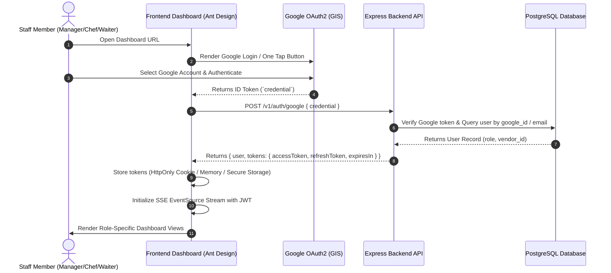

# ============================================================================
# QR-ORDER SAAS: FRONTEND REQUIREMENTS DOCUMENT (DASHBOARD-FRD)
# RESTAURANT & CAFE OPERATIONS DASHBOARD (ADMIN, MANAGER, CHEF, WAITER)
# ============================================================================
# Version: 1.0.0 (Production Architecture)
# Architecture: Single-Page Application (SPA) / React / TypeScript / Ant Design
# Communication Protocol: REST API (JSON) + Server-Sent Events (SSE) Real-Time Stream
# Security Scope: Multi-Tenant Scoped (Strict Vendor Isolation), Google OAuth2, JWT Bearer
# Audience: Frontend Engineers, System Architects, QA Engineers
# ============================================================================

---

## 1. SCOPE & ROLE-BASED ACCESS CONTROL (RBAC)

### 1.1 Target Application Scope
This Frontend Requirements Document (FRD) defines the complete technical, architectural, and API integration specifications for the **Restaurant & Operations Dashboard**.

> [!IMPORTANT]
> **Strict Scope Boundary:**
> 1. **Excluded Roles**: This client is **NOT** accessible to `SUPER_ADMIN`. Platform super-admin capabilities (such as onboarding new vendors, cross-tenant system metrics, platform billing configurations) are strictly prohibited and stripped from this client.
> 2. **Excluded Customer Flows**: Public customer QR ordering, customer menu browsing, and customer checkout flows belong to the **Customer Web App**, not this dashboard.
> 3. **Elimination of Dummy Features**: Courier fleets, third-party logistics dispatch, shipping manifests, and external delivery driver integrations are **removed**. All operational workflows correspond 1:1 with the active PostgreSQL and MongoDB backend services.

### 1.2 User Persona & Permission Matrix

| Feature / Page Route | `ADMIN` (Franchise Owner) | `MANAGER` (Store General Manager) | `CHEF` (Head Cook / Kitchen Staff) | `WAITER` (Floor Staff / Captain) |
| :--- | :---: | :---: | :---: | :---: |
| **Google OAuth2 Login / Logout** | Full | Full | Full | Full |
| **Live Kitchen Display (KDS)** | Read-Only | Full Access | Full Access | View Ready Items |
| **Orders List & Dynamic Query** | Full Access | Full Access | Kitchen Scoped | Floor Scoped |
| **Order Manual Punching (Floor)** | Allowed | Allowed | Denied | Allowed |
| **Order State Machine Transitions** | Full Access | Full Access | `ACCEPTED` -> `PREPARING` -> `READY` | `READY` -> `SERVED` |
| **Prepaid Payment Confirmation** | Allowed | Allowed | Denied | Denied |
| **Postpaid Bill Settlement** | Allowed | Allowed | Denied | Allowed |
| **Floor Assistance / Service Requests** | Full Access | Full Access | Denied | Full Access (Resolve) |
| **Digital Menu Editor (MongoDB)** | Full Access | Full Access | Denied | Denied |
| **QR Booths Management & Printing** | Full Access | Full Access | Denied | Read-Only |
| **Staff & Account Management** | Full Access | Manage Staff | Denied | Denied |
| **Subscription & Plan Audit** | Full Access | View Only | Denied | Denied |
| **Analytics & Sales Trend Reports** | Full Access | Full Access | Top Items Only | Denied |
| **Invoice & POS Slip Printing** | Allowed | Allowed | Kitchen Slip Only | Order Receipt Only |
| **CSV Data Export** | Allowed | Allowed | Denied | Denied |

---

## 2. SYSTEM ARCHITECTURE & INTEGRATION LOGIC

### 2.1 Technology & Tooling Stack
- **Framework**: React 18+ (Vite or Next.js SPA mode) with TypeScript strict mode.
- **UI Library**: Ant Design (v5+) with modular component overrides (using existing corporate design tokens).
- **State & Server Cache**: TanStack React Query (v5+) with aggressive caching and optimistic UI updates.
- **Client State**: Zustand (for auth session, active booth filters, audio state, and sound alerts).
- **HTTP Client**: Axios with interceptors, JWT refresh pipeline, and request deduplication.
- **Real-Time Stream**: Native `EventSource` (SSE) client wrapper with exponential backoff auto-reconnection.
- **Printing**: Native browser `window.print()` triggered via hidden CSS media print layout (80mm/58mm thermal receipts & A4 invoices).
- **QR Generation**: `qrcode.react` (SVG mode with embedded logo support).

### 2.2 Global Communication & Environment Config
The client loads base variables from environment files (`.env.production`, `.env.development`):

```env
VITE_API_BASE_URL=https://api.yourdomain.com/v1
VITE_SSE_STREAM_URL=https://api.yourdomain.com/v1/events/stream
VITE_GOOGLE_CLIENT_ID=xxxxxxxxxxxx.apps.googleusercontent.com
VITE_CUSTOMER_PORTAL_URL=https://menu.yourdomain.com
VITE_DEFAULT_PAGE_SIZE=12
```

---

## 3. AUTHENTICATION & MULTI-TENANT SESSION MANAGEMENT

### 3.1 Google Identity Services (GIS) Flow
The dashboard exclusively authenticates users through **Google OAuth2** (Google One Tap / GIS Button). Traditional username/password forms are disabled.



### 3.2 Authentication API Contracts

#### A. Google Login / Auto-Signup
- **Endpoint**: `POST /v1/auth/google`
- **Access**: Public
- **Request Headers**: `Content-Type: application/json`
- **Request Body**:
  ```json
  {
    "credential": "eyJhbGciOiJSUzI1NiIsImtpZCI6Ij..."
  }
  ```
- **Response Format (`200 OK`)**:
  ```json
  {
    "success": true,
    "message": "Google authentication successful",
    "data": {
      "user": {
        "id": "usr_7kJ2n9Xm4Pq1L8wZ",
        "email": "manager.patia@chaibreak.com",
        "full_name": "Rohan Senapati",
        "role": "MANAGER",
        "vendor_id": "vnd_9mK3xP8q1L2w7Z0A",
        "avatar_url": "https://lh3.googleusercontent.com/a/..."
      },
      "tokens": {
        "accessToken": "eyJhbGciOiJIUzI1NiIsInR5cCI6IkpXVCJ9...",
        "refreshToken": "eyJhbGciOiJIUzI1NiIsInR5cCI6IkpXVCJ9...",
        "expiresIn": 900
      }
    }
  }
  ```
- **Error Responses**:
  - `401 Unauthorized`: `{ "success": false, "message": "Account is suspended or inactive" }`
  - `400 Bad Request`: `{ "success": false, "message": "Google credential token is required" }`

#### B. Token Refresh Pipeline
- **Endpoint**: `POST /v1/auth/refresh-token`
- **Access**: Public
- **Request Body**:
  ```json
  {
    "refreshToken": "eyJhbGciOiJIUzI1NiIsInR5cCI6IkpXVCJ9..."
  }
  ```
- **Response Format (`200 OK`)**:
  ```json
  {
    "success": true,
    "message": "Tokens refreshed successfully",
    "data": {
      "accessToken": "eyJhbGciOiJIUzI1NiIsInR5cCI6IkpXVCJ9...",
      "refreshToken": "eyJhbGciOiJIUzI1NiIsInR5cCI6IkpXVCJ9...",
      "expiresIn": 900
    }
  }
  ```

#### C. Active User Profile Verification
- **Endpoint**: `GET /v1/auth/me`
- **Access**: Authenticated (`ADMIN`, `MANAGER`, `CHEF`, `WAITER`)
- **Headers**: `Authorization: Bearer <accessToken>`
- **Response Format (`200 OK`)**:
  ```json
  {
    "success": true,
    "data": {
      "id": "usr_7kJ2n9Xm4Pq1L8wZ",
      "email": "manager.patia@chaibreak.com",
      "full_name": "Rohan Senapati",
      "phone": "+919876543210",
      "role": "MANAGER",
      "status": "ACTIVE",
      "vendor_id": "vnd_9mK3xP8q1L2w7Z0A",
      "avatar_url": "https://lh3.googleusercontent.com/..."
    }
  }
  ```

### 3.3 Axios Interceptor & Silent Token Refresh Logic
```typescript
import axios from "axios";
import { useAuthStore } from "../store/auth.store";

export const apiClient = axios.create({
  baseURL: import.meta.env.VITE_API_BASE_URL,
  timeout: 15000,
});

apiClient.interceptors.request.use((config) => {
  const token = useAuthStore.getState().accessToken;
  if (token) {
    config.headers.Authorization = `Bearer ${token}`;
  }
  return config;
});

let isRefreshing = false;
let failedQueue: Array<{ resolve: (token: string) => void; reject: (err: any) => void }> = [];

const processQueue = (error: any, token: string | null = null) => {
  failedQueue.forEach((prom) => {
    if (error) {
      prom.reject(error);
    } else {
      prom.resolve(token!);
    }
  });
  failedQueue = [];
};

apiClient.interceptors.response.use(
  (response) => response,
  async (error) => {
    const originalRequest = error.config;
    if (error.response?.status === 401 && !originalRequest._retry) {
      if (isRefreshing) {
        return new Promise((resolve, reject) => {
          failedQueue.push({ resolve, reject });
        })
          .then((token) => {
            originalRequest.headers.Authorization = `Bearer ${token}`;
            return apiClient(originalRequest);
          })
          .catch((err) => Promise.reject(err));
      }

      originalRequest._retry = true;
      isRefreshing = true;

      const refreshToken = useAuthStore.getState().refreshToken;
      if (!refreshToken) {
        useAuthStore.getState().logout();
        return Promise.reject(error);
      }

      try {
        const { data } = await axios.post(
          `${import.meta.env.VITE_API_BASE_URL}/auth/refresh-token`,
          { refreshToken }
        );
        const { accessToken, refreshToken: newRefreshToken } = data.data;
        useAuthStore.getState().setTokens(accessToken, newRefreshToken);
        processQueue(null, accessToken);
        originalRequest.headers.Authorization = `Bearer ${accessToken}`;
        return apiClient(originalRequest);
      } catch (refreshErr) {
        processQueue(refreshErr, null);
        useAuthStore.getState().logout();
        return Promise.reject(refreshErr);
      } finally {
        isRefreshing = false;
      }
    }
    return Promise.reject(error);
  }
);
```

---

## 4. REAL-TIME EVENT STREAM (SSE) & ZERO-LATENCY CACHE SYNC

### 4.1 Connection Lifecycle
The dashboard opens a single persistent `EventSource` connection to `GET /v1/events/stream`.

```
Client Dashboard (Bearer Token / ?token=...)
        |
        v
GET /v1/events/stream?token=<JWT>
        |
   HTTP 200 OK (Content-Type: text/event-stream)
        |
   event: CONNECTED -> Handshake frame (clientId, vendorId, role)
        |
   event: <EVENT_TYPE> -> Real-time operational dispatch
        |
   Heartbeat (: ping) every 25 seconds (prevents proxy timeouts)
```

### 4.2 Browser Notification & Audio Cues Integration
1. **Initial Permission Request**:
   On the first successful login of any user (`ADMIN`, `MANAGER`, `CHEF`, `WAITER`), the dashboard renders a modal banner requesting browser notification permission:
   ```typescript
   if ("Notification" in window && Notification.permission === "default") {
     Notification.requestPermission();
   }
   ```
2. **Audio Cue Chimes**:
   Pre-loaded high-bitrate audio assets bundled in `/public/sounds/`:
   - `bell_soft.mp3`: Subtle chime for newly placed prepaid orders awaiting approval.
   - `bell_kds.mp3`: Kitchen ticket printer / bell ring when an order is accepted for cooking.
   - `bell_loud.mp3`: Double bell chime when food is marked `READY` for table service.
   - `waiter_chime.mp3`: Ding-dong chime when a customer triggers a floor service request.
   - `alert_warning.mp3`: High-priority alert sound for order cancellation/rejection.

### 4.3 SSE Event Matrix & Cache Invalidation Map

| SSE Event Name | Target Roles | Sound Cue | React Query Cache Action |
| :--- | :--- | :--- | :--- |
| `CONNECTED` | `ALL` | None | Set connection state badge to `ONLINE` |
| `ORDER_INITIATED` | `MANAGER` | `bell_soft` | Invalidate `["orders", "pending-approval"]` & trigger AntD Notification |
| `ORDER_ACCEPTED_FOR_KITCHEN` | `CHEF`, `MANAGER` | `bell_kds` | Prepend order into `["orders", "active"]` (KDS Board) |
| `ORDER_STATUS_UPDATED` | `ALL` | Contextual | Update order record in `["orders", "active"]` and `["orders", "search"]` |
| `ORDER_PREPARING` | `WAITER`, `MANAGER` | None | Update badge status to `PREPARING` in order tables |
| `ORDER_READY_FOR_TABLE` | `WAITER`, `MANAGER` | `bell_loud` | Move ticket to "Ready for Pickup" column; push floor notification |
| `ORDER_CANCELLED` | `CHEF`, `MANAGER`, `WAITER` | `alert_warning` | Remove from `["orders", "active"]`; show red warning banner |
| `ORDER_SERVED` | `ALL` | None | Remove from KDS active board; append to history |
| `SERVICE_REQUEST_CREATED` | `WAITER`, `MANAGER` | `waiter_chime` | Invalidate `["service-requests", "search"]`; show floating bell badge |
| `SERVICE_REQUEST_RESOLVED` | `WAITER`, `MANAGER` | None | Invalidate `["service-requests", "search"]` |

---

## 5. DYNAMIC SEARCH, FILTERING & PAGINATION ENGINE

### 5.1 Universal Query Contract
All tabular management views (`orders`, `users`, `qr-booths`, `service-requests`, `subscriptions`) query the unified `GET /v1/<resource>/search-query` endpoint.

#### Standard Query Parameters:
| Parameter | Type | Default | Description |
| :--- | :--- | :--- | :--- |
| `page` | `number` | `1` | 1-indexed target page number. |
| `limit` | `number` | `12` | Items per page (default is strictly 12; maximum 100). |
| `sortBy` | `string` | Table default | Column to order by (e.g. `placed_at`, `created_at`, `total_paise`). |
| `sortOrder` | `string` | `DESC` | Sorting direction: `ASC` or `DESC`. |
| `search` or `q` | `string` | `""` | Free-text search matching across multiple entity columns. |
| `from_date` | `ISO 8601` | `undefined` | Filter records on primary timestamp `>= from_date`. |
| `to_date` | `ISO 8601` | `undefined` | Filter records on primary timestamp `<= to_date`. |
| `<col>_gte` | `number/date` | `undefined` | Greater than or equal filter for column. |
| `<col>_lte` | `number/date` | `undefined` | Less than or equal filter for column. |
| `<col>` | `string` | `undefined` | Exact match or comma-delimited `IN` list (e.g. `status=ACCEPTED,READY`). |
| `<col>_null` | `boolean` | `undefined` | Null check (`true` for `IS NULL`, `false` for `IS NOT NULL`). |

#### Standard Response Format:
```json
{
  "success": true,
  "data": [ ... ],
  "pagination": {
    "total": 128,
    "page": 1,
    "limit": 12,
    "totalPages": 11,
    "hasNextPage": true,
    "hasPrevPage": false
  }
}
```

### 5.2 Ant Design Table Integration Hook (`useDynamicQuery`)
```typescript
import { useState, useMemo } from "react";
import { useQuery } from "@tanstack/react-query";
import { apiClient } from "../services/api";

interface UseDynamicQueryOptions {
  resource: string;
  defaultSortBy?: string;
  defaultSortOrder?: "ASC" | "DESC";
  initialFilters?: Record<string, any>;
}

export function useDynamicQuery<T>({
  resource,
  defaultSortBy = "created_at",
  defaultSortOrder = "DESC",
  initialFilters = {},
}: UseDynamicQueryOptions) {
  const [page, setPage] = useState(1);
  const [limit, setLimit] = useState(12);
  const [sortBy, setSortBy] = useState(defaultSortBy);
  const [sortOrder, setSortOrder] = useState<"ASC" | "DESC">(defaultSortOrder);
  const [search, setSearch] = useState("");
  const [filters, setFilters] = useState<Record<string, any>>(initialFilters);

  const queryParams = useMemo(() => {
    const params: Record<string, any> = {
      page,
      limit,
      sortBy,
      sortOrder,
      ...filters,
    };
    if (search.trim()) params.search = search.trim();
    return params;
  }, [page, limit, sortBy, sortOrder, search, filters]);

  const query = useQuery({
    queryKey: [resource, "search-query", queryParams],
    queryFn: async () => {
      const { data } = await apiClient.get(`/${resource}/search-query`, {
        params: queryParams,
      });
      return data;
    },
    placeholderData: (previousData) => previousData,
    staleTime: 10000,
  });

  const handleTableChange = (pagination: any, tableFilters: any, sorter: any) => {
    if (pagination.current) setPage(pagination.current);
    if (pagination.pageSize) setLimit(pagination.pageSize);
    if (sorter.field) {
      setSortBy(sorter.field);
      setSortOrder(sorter.order === "ascend" ? "ASC" : "DESC");
    }
  };

  return {
    items: (query.data?.data as T[]) || [],
    pagination: query.data?.pagination,
    isLoading: query.isLoading,
    isFetching: query.isFetching,
    page,
    limit,
    search,
    setSearch,
    setFilters,
    setPage,
    handleTableChange,
    refetch: query.refetch,
  };
}
```

---

## 6. MODULE SPECIFICATIONS & COMPLETE API CONTRACTS

```
                                DASHBOARD NAVIGATION
  +-------------------------------------------------------------------------------+
  |  [Live KDS]     [Orders Manager]    [Menu Editor]   [Floor & Requests]       |
  |  (CHEF/MGR)      (ALL ROLES)        (ADMIN/MGR)      (WAITER/MGR)            |
  |                                                                               |
  |  [QR Booths]    [Staff Team]        [Billing Plan]  [Analytics & Reports]    |
  |  (ADMIN/MGR)     (ADMIN/MGR)        (ADMIN/MGR)      (ADMIN/MGR/CHEF)        |
  +-------------------------------------------------------------------------------+
```

---

### 6.1 Orders Management & Live Tracking
- **Authorized Roles**: `ADMIN`, `MANAGER`, `CHEF`, `WAITER`.

#### UI Layout & Features:
1. **Status Tabs**: Quick filtering by status presets:
   - `All Orders`
   - `Live / In-Progress` (`INITIATED,ACCEPTED,PREPARING,READY`)
   - `Completed` (`SERVED`)
   - `Cancelled / Dropped` (`CANCELLED,REJECTED`)
2. **Dynamic Range Filtering**:
   - Filter by date range (Today, Yesterday, Last 7 Days, Custom Timestamps).
   - Filter by booth / table dropdown (`qr_booth_id`).
   - Filter by payment status (`PENDING`, `PAID`).
   - Filter by payment method (`CASH`, `UPI`, `CARD`, `ONLINE`).
   - Filter by order total amount range (`total_paise_gte`, `total_paise_lte`).
3. **Action Buttons**:
   - `View Ticket`: Opens detail drawer with line items, variants, addons, and notes.
   - `Confirm Payment`: For prepaid orders awaiting payment verification.
   - `Settle Bill`: For postpaid orders to record payment method (`CASH`, `UPI`, `CARD`) and mark `PAID`.
   - `Print Receipt`: Immediate trigger for 80mm POS receipt.
   - `Cancel Order`: Prompt with cancellation reason input.

#### API Contracts:

##### 1. Dynamic Search Orders
- **Route**: `GET /v1/orders/search-query`
- **Headers**: `Authorization: Bearer <token>`
- **Query Parameters**:
  - `page`: `1` (default)
  - `limit`: `12` (default)
  - `sortBy`: `placed_at` | `total_paise` | `order_no` (default `placed_at`)
  - `sortOrder`: `DESC` | `ASC` (default `DESC`)
  - `status`: `INITIATED` | `ACCEPTED` | `PREPARING` | `READY` | `SERVED` | `CANCELLED` | `REJECTED` (supports comma lists: `status=ACCEPTED,PREPARING`)
  - `payment_status`: `PENDING` | `PAID` | `NOT_REQUIRED` | `REFUNDED`
  - `payment_method`: `CASH` | `UPI` | `CARD` | `ONLINE`
  - `qr_booth_id`: string (UUID or Stripe-style `bth_...`)
  - `from_date` / `to_date`: ISO string
  - `total_paise_gte` / `total_paise_lte`: number
  - `search`: string (matches customer name, phone, booth label, ref_token, id)
- **Response Format (`200 OK`)**:
  ```json
  {
    "success": true,
    "data": [
      {
        "id": "ord_8kJ3n9Xm4Pq1L8wZ",
        "vendor_id": "vnd_9mK3xP8q1L2w7Z0A",
        "order_no": 42,
        "order_date": "2026-10-03",
        "ref_token": "7A29",
        "qr_booth_id": "bth_1mK3xP8q1L2w7Z0A",
        "booth_label": "Table 12",
        "source": "QR",
        "status": "ACCEPTED",
        "payment_status": "PAID",
        "payment_method": "UPI",
        "customer_name": "Aman Verma",
        "customer_phone": "+919876543210",
        "customer_note": "Extra spicy, less oil",
        "currency": "INR",
        "item_details": [
          {
            "item_id": "itm_burger_01",
            "name": "Smoked Paneer Burger",
            "price_paise": 24900,
            "qty": 2,
            "variant_id": "var_reg",
            "variant_name": "Regular",
            "addons": [{ "id": "add_cheese", "name": "Extra Cheese Slice", "price_paise": 3000 }],
            "item_total_paise": 55800
          }
        ],
        "subtotal_paise": 55800,
        "discount_paise": 0,
        "tax_paise": 2790,
        "extra_tips_paise": 0,
        "total_paise": 58590,
        "placed_at": "2026-10-03T10:15:30.000Z",
        "updated_at": "2026-10-03T10:16:10.000Z"
      }
    ],
    "pagination": {
      "total": 1,
      "page": 1,
      "limit": 12,
      "totalPages": 1,
      "hasNextPage": false,
      "hasPrevPage": false
    }
  }
  ```

##### 2. Confirm Prepaid Order Payment (Manager / Admin)
- **Route**: `POST /v1/orders/confirm-payment/:id`
- **Headers**: `Authorization: Bearer <token>`
- **Request Body**:
  ```json
  {
    "payment_method": "ONLINE"
  }
  ```
- **Response Format (`200 OK`)**:
  ```json
  {
    "success": true,
    "message": "Payment confirmed and order accepted for kitchen",
    "data": {
      "id": "ord_8kJ3n9Xm4Pq1L8wZ",
      "status": "ACCEPTED",
      "payment_status": "PAID"
    }
  }
  ```

##### 3. Settle Postpaid Payment
- **Route**: `PATCH /v1/orders/update-payment/:id`
- **Headers**: `Authorization: Bearer <token>`
- **Request Body**:
  ```json
  {
    "payment_status": "PAID",
    "payment_method": "CASH"
  }
  ```
- **Response Format (`200 OK`)**:
  ```json
  {
    "success": true,
    "message": "Payment settlement updated successfully",
    "data": {
      "id": "ord_8kJ3n9Xm4Pq1L8wZ",
      "payment_status": "PAID",
      "payment_method": "CASH"
    }
  }
  ```

##### 4. Order State Machine Transition
- **Route**: `PATCH /v1/orders/update-status/:id`
- **Headers**: `Authorization: Bearer <token>`
- **Request Body**:
  ```json
  {
    "status": "PREPARING"
  }
  ```
  *(Allowed values: `ACCEPTED`, `PREPARING`, `READY`, `SERVED`, `CANCELLED`, `REJECTED`)*
- **Response Format (`200 OK`)**:
  ```json
  {
    "success": true,
    "message": "Order status updated to PREPARING",
    "data": {
      "id": "ord_8kJ3n9Xm4Pq1L8wZ",
      "status": "PREPARING"
    }
  }
  ```

##### 5. Order Handoff & Customer Token Verification
- **Route**: `POST /v1/orders/serve/:id`
- **Headers**: `Authorization: Bearer <token>`
- **Request Body**:
  ```json
  {
    "ref_token": "7A29"
  }
  ```
  *(Note: Passing `ref_token` verifies token match against order; optional bypass for managers)*
- **Response Format (`200 OK`)**:
  ```json
  {
    "success": true,
    "message": "Order handed off and marked SERVED",
    "data": {
      "id": "ord_8kJ3n9Xm4Pq1L8wZ",
      "status": "SERVED"
    }
  }
  ```

##### 6. Cancel Order
- **Route**: `POST /v1/orders/cancel/:id`
- **Headers**: `Authorization: Bearer <token>`
- **Request Body**:
  ```json
  {
    "reason": "Customer changed mind before kitchen started"
  }
  ```
- **Response Format (`200 OK`)**:
  ```json
  {
    "success": true,
    "message": "Order cancelled successfully",
    "data": {
      "id": "ord_8kJ3n9Xm4Pq1L8wZ",
      "status": "CANCELLED"
    }
  }
  ```

##### 7. Punch Manual Order (Staff / Waiter Floor Order)
- **Route**: `POST /v1/orders/create`
- **Headers**: `Authorization: Bearer <token>`
- **Request Body**:
  ```json
  {
    "qr_booth_id": "bth_1mK3xP8q1L2w7Z0A",
    "customer_name": "Walk-in Guest",
    "customer_phone": "+919876543210",
    "customer_note": "No onion",
    "source": "STAFF",
    "item_details": [
      {
        "item_id": "itm_burger_01",
        "name": "Smoked Paneer Burger",
        "variant_id": "var_reg",
        "variant_name": "Regular",
        "price_paise": 24900,
        "qty": 1,
        "addons": [],
        "item_total_paise": 24900
      }
    ],
    "subtotal_paise": 24900,
    "discount_paise": 0,
    "tax_paise": 1245,
    "extra_tips_paise": 0,
    "total_paise": 26145
  }
  ```

---

### 6.2 Kitchen Display System (KDS)
- **Authorized Roles**: `CHEF`, `MANAGER`.

#### UI Layout & Features:
- **Card-Based Kanban Flow**: Three auto-refreshing visual columns:
  1. **New Incoming / Accepted** (`ACCEPTED`): Flashing border, timer counting up in minutes since placed.
  2. **Preparing in Kitchen** (`PREPARING`): Cooking indicator, elapsed time tracker.
  3. **Ready for Service** (`READY`): Awaiting floor waiter pickup or takeaway counter handoff.
- **Ticket Anatomy**:
  - Top Bar: Daily Order Number (`#42`), Table/Booth Label (`Table 12`), Elapsed Time (`4m 12s` with color change: Green < 10m, Orange 10-20m, Red > 20m).
  - Customer Verification Token: Highlighted badge (`Token: 7A29`).
  - Item List: Strikethrough checkbox for each line item (chef can cross off items as they finish).
  - Special Cooking Instructions: Highlighted yellow tag (`customer_note`).
- **One-Touch Action Buttons**:
  - `Start Cooking`: Transitions `ACCEPTED` -> `PREPARING`.
  - `Mark Ready`: Transitions `PREPARING` -> `READY` (triggers loud bell audio cue on floor devices).
  - `Reject`: Prompt reason dialog.

#### API Contract:
- **Endpoint**: `GET /v1/orders/active`
- **Headers**: `Authorization: Bearer <token>`
- **Response Format (`200 OK`)**:
  ```json
  {
    "success": true,
    "data": [
      {
        "id": "ord_8kJ3n9Xm4Pq1L8wZ",
        "order_no": 42,
        "order_date": "2026-10-03",
        "ref_token": "7A29",
        "booth_label": "Table 12",
        "status": "PREPARING",
        "customer_note": "No garlic",
        "item_details": [
          {
            "name": "Smoked Paneer Burger",
            "qty": 2,
            "variant_name": "Spicy",
            "addons": []
          }
        ],
        "placed_at": "2026-10-03T10:15:30.000Z"
      }
    ]
  }
  ```

---

### 6.3 Floor Assistance & Service Requests ("Call Waiter")
- **Authorized Roles**: `WAITER`, `MANAGER`, `ADMIN`.

#### UI Layout & Features:
- **Live Assistance Feed**: Top floating alert drawer + dedicated table view.
- **Request Type Badges**:
  - `WATER`: Cyan badge with drop icon.
  - `TISSUE`: Gray badge with napkin icon.
  - `CLEANING`: Orange badge with broom icon.
  - `BILL`: Green badge with receipt icon.
  - `WAITER_CALL`: Red flashing badge with bell icon.
- **Quick Resolve Action**: Single-click "Acknowledge / Resolve" button. Automatically stamps staff `user_id` and timestamp.

#### API Contracts:

##### 1. Dynamic Search Service Requests
- **Route**: `GET /v1/service-requests/search-query`
- **Headers**: `Authorization: Bearer <token>`
- **Query Parameters**:
  - `page`: `1` (default)
  - `limit`: `12` (default)
  - `status`: `PENDING` | `ACKNOWLEDGED` | `RESOLVED` | `CANCELLED` (default `PENDING,ACKNOWLEDGED`)
  - `request_type`: `WATER` | `TISSUE` | `CLEANING` | `BILL` | `WAITER_CALL` | `OTHER`
  - `sortBy`: `created_at` (default `DESC`)
- **Response Format (`200 OK`)**:
  ```json
  {
    "success": true,
    "data": [
      {
        "id": "req_8mK3xP8q1L2w7Z0A",
        "vendor_id": "vnd_9mK3xP8q1L2w7Z0A",
        "qr_booth_id": "bth_1mK3xP8q1L2w7Z0A",
        "booth_label": "Table 04",
        "request_type": "WATER",
        "status": "PENDING",
        "resolved_by": null,
        "created_at": "2026-10-03T10:20:00.000Z",
        "resolved_at": null
      }
    ],
    "pagination": {
      "total": 1,
      "page": 1,
      "limit": 12,
      "totalPages": 1,
      "hasNextPage": false,
      "hasPrevPage": false
    }
  }
  ```

##### 2. Mark Service Request Resolved
- **Route**: `PATCH /v1/service-requests/resolve/:id`
- **Headers**: `Authorization: Bearer <token>`
- **Response Format (`200 OK`)**:
  ```json
  {
    "success": true,
    "message": "Service request marked as resolved",
    "data": {
      "id": "req_8mK3xP8q1L2w7Z0A",
      "status": "RESOLVED",
      "resolved_at": "2026-10-03T10:22:15.000Z"
    }
  }
  ```

---

### 6.4 QR Booths Infrastructure & Table Management
- **Authorized Roles**: `ADMIN`, `MANAGER` (Read-only for `WAITER`).

#### UI Layout & Features:
1. **Booth Grid / Card View**:
   - Visual floor map organized by Zones (`Terrace`, `Indoor AC`, `Main Dining`, `Delivery Point`).
   - Card stats: Table label, seats capacity, active status switch, unique QR code key.
2. **QR Code Action Modal**:
   - Live rendering of QR code with restaurant logo in center.
   - Target URL preview: `${VITE_CUSTOMER_PORTAL_URL}/v/${vendor.slug}?bth=${qr_code_key}`.
   - Quick Download buttons: `Download PNG`, `Download SVG`.
   - `Print Standee / Tent Card`: Generates an attractive print card with table label and instructions.
3. **Create & Edit Drawer**:
   - Fields: `label` (e.g. 'T-14'), `zone` (e.g. 'Rooftop'), `seats` (e.g. 4), `is_active` (boolean toggle).

#### API Contracts:

##### 1. Dynamic Search QR Booths
- **Route**: `GET /v1/qr-booths/search-query`
- **Headers**: `Authorization: Bearer <token>`
- **Query Parameters**:
  - `page`: `1` (default)
  - `limit`: `12` (default)
  - `sortBy`: `label` | `seats` | `zone` | `created_at` (default `label ASC`)
  - `is_active`: `true` | `false`
  - `search`: string (matches label, zone, qr_code_key)
- **Response Format (`200 OK`)**:
  ```json
  {
    "success": true,
    "data": [
      {
        "id": "bth_1mK3xP8q1L2w7Z0A",
        "vendor_id": "vnd_9mK3xP8q1L2w7Z0A",
        "label": "Table 01",
        "zone": "Indoor AC",
        "seats": 4,
        "qr_code_key": "qr_ab39f72c109",
        "is_active": true,
        "created_at": "2026-09-15T08:00:00.000Z",
        "updated_at": "2026-09-15T08:00:00.000Z"
      }
    ],
    "pagination": {
      "total": 1,
      "page": 1,
      "limit": 12,
      "totalPages": 1,
      "hasNextPage": false,
      "hasPrevPage": false
    }
  }
  ```

##### 2. Create New Booth
- **Route**: `POST /v1/qr-booths/create`
- **Headers**: `Authorization: Bearer <token>`
- **Request Body**:
  ```json
  {
    "label": "Table 15",
    "zone": "Terrace",
    "seats": 6
  }
  ```
- **Response Format (`200 OK`)**:
  ```json
  {
    "success": true,
    "message": "Booth created successfully",
    "data": {
      "id": "bth_9mK3xP8q1L2w7Z0B",
      "label": "Table 15",
      "zone": "Terrace",
      "seats": 6,
      "qr_code_key": "qr_98fbc1023a",
      "is_active": true
    }
  }
  ```

##### 3. Update Booth Details
- **Route**: `PATCH /v1/qr-booths/update-details/:id`
- **Headers**: `Authorization: Bearer <token>`
- **Request Body**:
  ```json
  {
    "label": "Table 15 - VIP",
    "seats": 8,
    "is_active": true
  }
  ```

##### 4. Delete Booth
- **Route**: `DELETE /v1/qr-booths/delete/:id`
- **Headers**: `Authorization: Bearer <token>`
- **Response Format (`200 OK`)**:
  ```json
  {
    "success": true,
    "message": "Booth deleted successfully"
  }
  ```

---

### 6.5 Digital Menu Management (MongoDB Schema)
- **Authorized Roles**: `ADMIN`, `MANAGER`.

#### UI Layout & Features:
- **Hierarchical Tree & Drag-and-Drop View**:
  - `Sections` (e.g. "Food Menu", "Beverages & Cocktails", "Desserts").
  - `Categories` (e.g. "Appetizers", "Gourmet Burgers", "Artisan Pizzas").
  - `Items` (e.g. "Smoked Paneer Burger"):
    - Base price in Rupees (automatically converts to `price_paise` = `price_inr * 100`).
    - Diet Tag: `VEG` (Green Dot), `NON_VEG` (Red Triangle), `EGG` (Yellow Dot), `VEGAN` (Green Leaf).
    - Pricing Type: `SINGLE` or `VARIANT` (e.g. Small, Medium, Large).
    - Addons Groups: (e.g. Extra Cheese, Dips, Beverage Combos).
    - In-Stock Toggle: Single switch to disable sold-out items in real-time.

#### API Contracts:

##### 1. Fetch Digital Menu Document
- **Route**: `GET /v1/menu/fetch-details`
- **Headers**: `Authorization: Bearer <token>`
- **Response Format (`200 OK`)**:
  ```json
  {
    "success": true,
    "data": {
      "menu_id": "menu_vnd_9mK3xP8q1L2w7Z0A",
      "vendor_id": "vnd_9mK3xP8q1L2w7Z0A",
      "status": "ACTIVE",
      "sections": [
        {
          "id": "sec_food",
          "name": "Food Menu",
          "sort_order": 1,
          "is_active": true,
          "categories": [
            {
              "id": "cat_burgers",
              "name": "Burgers",
              "sort_order": 1,
              "is_active": true,
              "items": [
                {
                  "id": "itm_burger_01",
                  "name": "Smoked Paneer Burger",
                  "description": "Cottage cheese smoked with peri-peri herbs",
                  "diet_type": "VEG",
                  "pricing_type": "SINGLE",
                  "base_price_paise": 24900,
                  "is_in_stock": true,
                  "variants": [],
                  "addons": []
                }
              ]
            }
          ]
        }
      ]
    }
  }
  ```

##### 2. Save Updated Digital Menu
- **Route**: `PUT /v1/menu/update-details`
- **Headers**: `Authorization: Bearer <token>`
- **Request Body**: Complete sanitized menu payload.
- **Response Format (`200 OK`)**:
  ```json
  {
    "success": true,
    "message": "Menu updated successfully",
    "data": { ... }
  }
  ```

---

### 6.6 Staff & Account Management
- **Authorized Roles**: `ADMIN`, `MANAGER`.

#### UI Layout & Features:
- **Staff Roster Table**:
  - Filter by role: `MANAGER`, `CHEF`, `WAITER`.
  - Filter by status: `ACTIVE`, `INACTIVE`, `SUSPENDED`.
  - Display: Avatar, Name, Email, Phone, Role badge, Status toggle.
- **Add Staff Member Modal**:
  - Form Fields: `full_name`, `email` (must be valid Google Account email), `phone`, `role` (`MANAGER`, `CHEF`, `WAITER`).

#### API Contracts:

##### 1. Dynamic Search Staff Users
- **Route**: `GET /v1/users/search-query`
- **Headers**: `Authorization: Bearer <token>`
- **Query Parameters**:
  - `page`: `1` (default)
  - `limit`: `12` (default)
  - `role`: `MANAGER` | `CHEF` | `WAITER`
  - `status`: `ACTIVE` | `INACTIVE` | `SUSPENDED`
  - `search`: string (matches full name, email, phone)
- **Response Format (`200 OK`)**:
  ```json
  {
    "success": true,
    "data": [
      {
        "id": "usr_7kJ2n9Xm4Pq1L8wZ",
        "vendor_id": "vnd_9mK3xP8q1L2w7Z0A",
        "email": "chef.rahul@chaibreak.com",
        "full_name": "Rahul Mohanty",
        "phone": "+919876543211",
        "role": "CHEF",
        "status": "ACTIVE",
        "avatar_url": "https://lh3.googleusercontent.com/...",
        "created_at": "2026-09-15T08:00:00.000Z"
      }
    ],
    "pagination": {
      "total": 1,
      "page": 1,
      "limit": 12,
      "totalPages": 1,
      "hasNextPage": false,
      "hasPrevPage": false
    }
  }
  ```

##### 2. Create Staff Member
- **Route**: `POST /v1/users/create`
- **Headers**: `Authorization: Bearer <token>`
- **Request Body**:
  ```json
  {
    "full_name": "Sunil Jena",
    "email": "sunil.waiter@chaibreak.com",
    "phone": "+919876543212",
    "role": "WAITER"
  }
  ```
- **Response Format (`200 OK`)**:
  ```json
  {
    "success": true,
    "message": "Staff member created successfully",
    "data": {
      "id": "usr_9kL1n9Xm4Pq1L8wA",
      "email": "sunil.waiter@chaibreak.com",
      "role": "WAITER",
      "status": "ACTIVE"
    }
  }
  ```

##### 3. Update Staff Status (Activate / Suspend)
- **Route**: `PATCH /v1/users/update-status/:id`
- **Headers**: `Authorization: Bearer <token>`
- **Request Body**:
  ```json
  {
    "status": "SUSPENDED"
  }
  ```

---

### 6.7 Subscription & Plan Audit
- **Authorized Roles**: `ADMIN`, `MANAGER`.

#### UI Layout & Features:
- **Current Plan Card**:
  - Plan Code & Name (e.g., `STANDARD` - Growth Plan).
  - Monthly/Annual billing indicator.
  - Active Booth Count vs Maximum Booths allowed (progress bar: e.g. `8 / 25 Booths Used`).
  - Next Billing Date / Grace Period Countdown.
- **Subscription History Table**:
  - Filter by `status` (`ACTIVE`, `TRIALING`, `PAST_DUE`, `EXPIRED`).
  - Columns: Period Start, Period End, Provider (`RAZORPAY`), Reference ID.

#### API Contract:
- **Route**: `GET /v1/subscriptions/search-query`
- **Headers**: `Authorization: Bearer <token>`
- **Query Parameters**:
  - `page`: `1` (default)
  - `limit`: `12` (default)
  - `sortBy`: `created_at` (default `DESC`)
- **Response Format (`200 OK`)**:
  ```json
  {
    "success": true,
    "data": [
      {
        "id": "sub_8kJ3n9Xm4Pq1L8wZ",
        "vendor_id": "vnd_9mK3xP8q1L2w7Z0A",
        "plan_id": "plan_standard",
        "plan_name": "Standard Growth",
        "plan_code": "STANDARD",
        "plan_price_inr": 999,
        "status": "ACTIVE",
        "current_period_start": "2026-10-01T00:00:00.000Z",
        "current_period_end": "2026-11-01T00:00:00.000Z",
        "payment_provider": "RAZORPAY",
        "payment_reference": "sub_Nx81jF872la",
        "created_at": "2026-10-01T00:00:00.000Z"
      }
    ],
    "pagination": {
      "total": 1,
      "page": 1,
      "limit": 12,
      "totalPages": 1,
      "hasNextPage": false,
      "hasPrevPage": false
    }
  }
  ```

---

### 6.8 Analytics & Business Intelligence
- **Authorized Roles**: `ADMIN`, `MANAGER` (Partial top-items for `CHEF`).

#### UI Layout & Features:
1. **KPI Metric Summary Cards**:
   - Gross Revenue (₹ formatted).
   - Total Orders Count.
   - Average Order Value (AOV in ₹).
   - Order Status Donut Chart (Served vs Cancelled vs Rejected).
2. **Sales Trend Graph**:
   - Timeframe toggles: `Today`, `This Week`, `This Month`, `Custom Range`.
   - Group By selector: `hour`, `day`, `week`, `month`.
   - Dual-axis Line/Bar chart (Revenue on left axis, Order Volume on right axis).
3. **Top Performing Items Table**:
   - Ranking (1 to 10), Item Name, Total Quantity Sold, Total Revenue Generated.
4. **Table / Booth Utilization Matrix**:
   - Highest revenue generating tables vs idle booths.
5. **Staff Order Punching Performance**:
   - Orders punched and served per waiter.

#### API Contracts:

##### 1. Overview KPI Stats
- **Route**: `GET /v1/analytics/overview`
- **Headers**: `Authorization: Bearer <token>`
- **Query Parameters**: `timeframe=today` | `week` | `month` | `custom&start_date=...&end_date=...`
- **Response Format (`200 OK`)**:
  ```json
  {
    "success": true,
    "data": {
      "total_revenue_paise": 18542000,
      "total_orders": 312,
      "served_orders": 298,
      "cancelled_orders": 10,
      "rejected_orders": 4,
      "average_order_value_paise": 59429
    }
  }
  ```

##### 2. Sales & Revenue Trends
- **Route**: `GET /v1/analytics/sales-trend?group_by=day&timeframe=month`
- **Headers**: `Authorization: Bearer <token>`
- **Response Format (`200 OK`)**:
  ```json
  {
    "success": true,
    "data": [
      {
        "period": "2026-10-01",
        "orders_count": 84,
        "revenue_paise": 4820000
      },
      {
        "period": "2026-10-02",
        "orders_count": 92,
        "revenue_paise": 5310000
      }
    ]
  }
  ```

##### 3. Top Selling Items
- **Route**: `GET /v1/analytics/top-items?limit=10&timeframe=month`
- **Headers**: `Authorization: Bearer <token>`
- **Response Format (`200 OK`)**:
  ```json
  {
    "success": true,
    "data": [
      {
        "item_id": "itm_burger_01",
        "name": "Smoked Paneer Burger",
        "quantity_sold": 142,
        "revenue_paise": 3535800
      }
    ]
  }
  ```

##### 4. Payment Methods Breakdown
- **Route**: `GET /v1/analytics/payment-methods?timeframe=month`
- **Headers**: `Authorization: Bearer <token>`
- **Response Format (`200 OK`)**:
  ```json
  {
    "success": true,
    "data": [
      { "payment_method": "UPI", "count": 210, "revenue_paise": 12450000 },
      { "payment_method": "CASH", "count": 72, "revenue_paise": 4120000 },
      { "payment_method": "CARD", "count": 30, "revenue_paise": 1972000 }
    ]
  }
  ```

##### 5. Daily End-of-Day Report (Z-Report)
- **Route**: `GET /v1/analytics/daily-report?date=2026-10-03`
- **Headers**: `Authorization: Bearer <token>`
- **Response Format (`200 OK`)**:
  ```json
  {
    "success": true,
    "data": {
      "date": "2026-10-03",
      "total_orders": 142,
      "total_revenue_paise": 8421000,
      "tax_collected_paise": 421050,
      "discounts_given_paise": 0,
      "tips_collected_paise": 12000,
      "cash_collected_paise": 2400000,
      "digital_collected_paise": 6021000
    }
  }
  ```

---

## 7. INVOICE & RECEIPT PRINTING SYSTEM

### 7.1 Receipt Architecture (80mm & 58mm Thermal Printing)
Thermal receipt printing triggers directly via CSS media queries (`@media print`) using a hidden React component container (`#thermal-receipt-root`).

#### 80mm Print CSS Template:
```css
@media print {
  body * {
    visibility: hidden;
  }
  #thermal-receipt-root, #thermal-receipt-root * {
    visibility: visible;
  }
  #thermal-receipt-root {
    position: absolute;
    left: 0;
    top: 0;
    width: 80mm;
    margin: 0;
    padding: 2mm;
    font-family: 'Courier New', monospace;
    font-size: 12px;
    line-height: 1.2;
    color: #000;
  }
  @page {
    size: 80mm auto;
    margin: 0;
  }
}
```

#### POS Slip Data Breakdown:
1. **Header**: Restaurant Name, Tagline, Address, Phone, FSSAI License Number.
2. **Order Metadata**: Date & Time (IST), Daily Order Number (`Order #42`), Table/Booth Label (`Table 12`).
3. **Verification Token**: Bold Prominent Box (`TOKEN: 7A29`).
4. **Itemized Table**:
   - `Item Name (Variant / Addons)`
   - `Qty  x  Price  =  Total`
5. **Totals Section**:
   - Subtotal (₹)
   - GST / Taxes (₹)
   - Discount (₹)
   - Final Amount Payable (₹)
   - Payment Status (`PAID via UPI` or `UNPAID / POSTPAID`)
6. **Footer**: "Thank you for visiting! Scan QR code on your table for instant orders."

---

## 8. QR CODE PRINTING & TABLE STANDEE GENERATOR

### 8.1 Standee Layout Specification
When a Manager clicks "Print Standee" on any QR Booth:
1. **Target Dimensions**: Standard A6 Tent Card (105mm x 148mm) or 4" x 6" Acrylic Standee.
2. **Components**:
   - Brand Logo & Restaurant Name.
   - Large Centered QR Code (250x250px SVG).
   - Table Number Banner: `TABLE 14` / `OUTDOOR PATIO`.
   - 3-Step Instruction Icons:
     1. Open Camera or Google Lens.
     2. Scan to View Menu.
     3. Order & Pay from your phone.
   - Wi-Fi Details Box (optional): SSID & Password.

---

## 9. CSV DATA EXPORT PIPELINE

### 9.1 Memory-Safe Export Method
For exporting large analytical lists or order histories without browser memory crashes:
```typescript
import { apiClient } from "../services/api";

export async function exportOrdersToCSV(filters: Record<string, any>) {
  // 1. Fetch full dataset using maximum safe batch limit
  const { data } = await apiClient.get("/orders/search-query", {
    params: { ...filters, page: 1, limit: 100 },
  });

  const orders = data.data;
  if (!orders || orders.length === 0) {
    throw new Error("No orders found matching selected filters.");
  }

  // 2. Map fields to CSV format
  const headers = [
    "Order ID", "Date", "Order No", "Ref Token", "Table Label", 
    "Status", "Payment Status", "Payment Method", "Customer Name", 
    "Customer Phone", "Subtotal (INR)", "Tax (INR)", "Total (INR)"
  ];

  const rows = orders.map((o: any) => [
    o.id,
    o.order_date,
    o.order_no,
    o.ref_token,
    o.booth_label || "Floor",
    o.status,
    o.payment_status,
    o.payment_method || "N/A",
    `"${(o.customer_name || "").replace(/"/g, '""')}"`,
    o.customer_phone || "",
    (o.subtotal_paise / 100).toFixed(2),
    (o.tax_paise / 100).toFixed(2),
    (o.total_paise / 100).toFixed(2)
  ]);

  const csvContent = "\uFEFF" + [headers.join(","), ...rows.map(r => r.join(","))].join("\r\n");
  const blob = new Blob([csvContent], { type: "text/csv;charset=utf-8;" });
  const url = URL.createObjectURL(blob);
  const link = document.createElement("a");
  link.setAttribute("href", url);
  link.setAttribute("download", `Orders_Export_${new Date().toISOString().slice(0, 10)}.csv`);
  document.body.appendChild(link);
  link.click();
  document.body.removeChild(link);
}
```

---

## 10. FRONTEND IMPLEMENTATION PROMPT (READY FOR DEVELOPERS)

> [!TIP]
> **Use the prompt below directly in your frontend coding assistant to generate or update the client codebase:**

```markdown
You are a principal frontend engineer building the Restaurant Operations Dashboard using React 18, TypeScript, and Ant Design (v5). 

Strict Architectural Constraints:
1. Target Roles ONLY: ADMIN, MANAGER, CHEF, WAITER. (Do NOT implement or expose any SUPER_ADMIN routes or APIs).
2. Authenticate strictly using Google OAuth2 (GIS) through backend POST /v1/auth/google. Store JWT in memory/cookies with automatic silent refresh via Axios interceptors on 401 responses.
3. Replace all previous unpaginated fetch endpoints with GET /v1/<resource>/search-query (default limit: 12), consuming { success: true, data: [...], pagination: { total, page, limit, totalPages, hasNextPage, hasPrevPage } }.
4. Real-time Synchronization: Establish persistent Server-Sent Events (SSE) via GET /v1/events/stream?token=<JWT>. Handle events:
   - ORDER_INITIATED -> soft bell sound cue, update pending tab
   - ORDER_ACCEPTED_FOR_KITCHEN -> kds bell sound cue, prepend to KDS board
   - ORDER_STATUS_UPDATED -> update ticket state
   - ORDER_READY_FOR_TABLE -> loud bell sound cue, alert waiter
   - ORDER_CANCELLED -> warning sound cue, remove from active board
   - SERVICE_REQUEST_CREATED -> waiter chime sound cue, add to assistance drawer
5. Kitchen Display System (KDS): Build high-contrast card board for CHEF with status transitions ACCEPTED -> PREPARING -> READY, order timer counting upwards, token badges, and strikethrough item checklists.
6. Floor Management: Build real-time assistance feed for WAITER with instant one-click resolution via PATCH /v1/service-requests/resolve/:id.
7. Thermal POS Printing: Build 80mm thermal receipt generator for orders with restaurant metadata, daily order number, ref_token, line items, taxes, and total payable in INR.
8. Table Standee QR Generator: Build QR Booth modal with QR code generation, SVG/PNG download, and printable A6 tent card layout.
9. Data Export: Implement CSV export utility for orders and analytical summaries.
10. Ensure zero latency, optimistic UI updates via TanStack React Query, and complete mobile/tablet responsiveness.
```

---

## 11. VERIFICATION & ACCEPTANCE CRITERIA

| Milestone / Requirement | Verification Criteria | Status |
| :--- | :--- | :--- |
| **Google Auth & RBAC** | Google One Tap exchanges token -> backend verifies -> returns JWT and role -> role guard redirects appropriately. | Ready for Integration |
| **SSE Real-Time Feed** | Open two browsers (Manager + Kitchen); punch order on one -> instant ticket appearance with audio chime on other without refresh. | Ready for Integration |
| **Dynamic Query Tables** | Page navigation, sorting, and status filtering update URL params and fetch exact 12 records with total count metadata. | Ready for Integration |
| **KDS Status Transitions** | Click "Start Cooking" -> status moves to `PREPARING` via `PATCH /v1/orders/update-status/:id` and updates live. | Ready for Integration |
| **POS Receipt Print** | Clicking print opens native print preview sized to 80mm with readable barcode/token, items, and tax breakdown. | Ready for Integration |
| **CSV Export** | Exports filtered orders to CSV with UTF-8 BOM encoding, correct INR currency conversion, and proper decimal places. | Ready for Integration |
