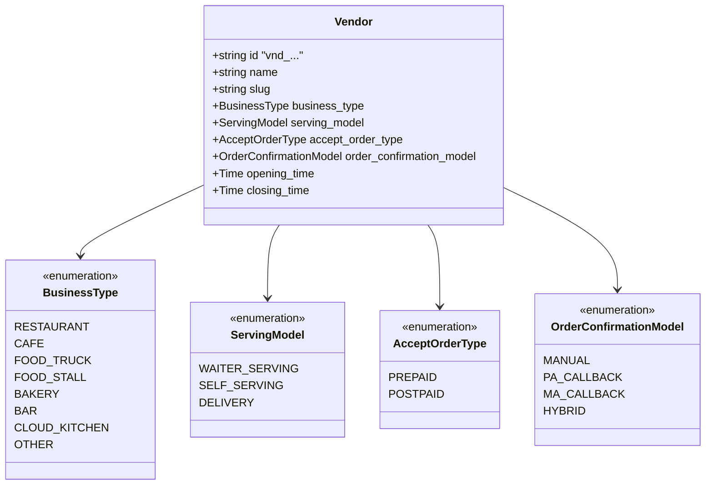
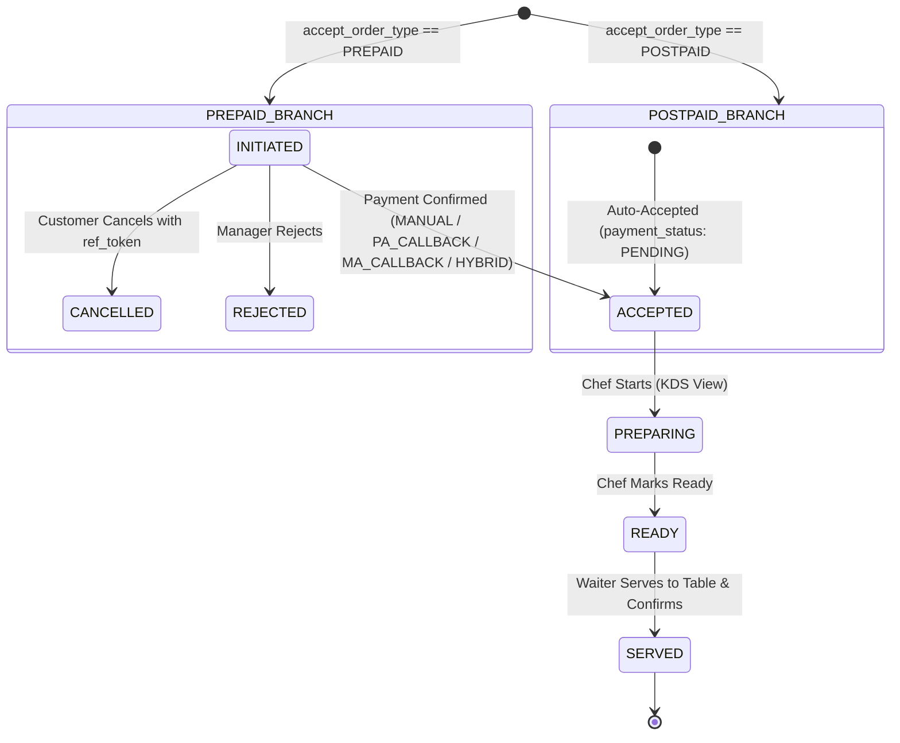
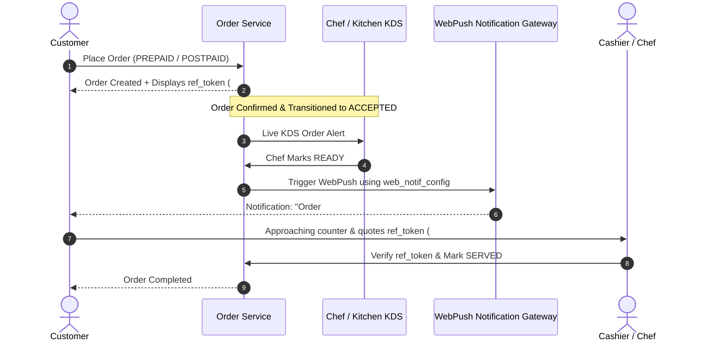
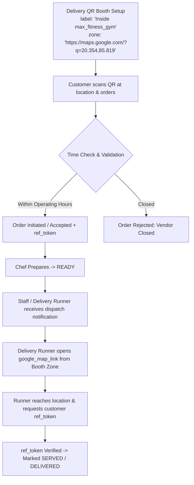

# Dynamic Vendor QR Ordering & Multi-Model Fulfillment Architecture

## Executive Summary & Architectural Evolution

Transform the existing single-vertical café QR ordering engine into a universal, multi-model food & beverage commerce platform. The platform is agnostic to business format (cafés, fine-dining restaurants, food trucks, food vans, stalls, kiosks, food courts, and cloud kitchens) and dynamically adapts ordering, payment, kitchen, notification, and fulfillment workflows based on tenant configuration.

---

## 1. Naming & Entity Terminology Decision

| Legacy Term | Universal Recommendation | Rationale |
|---|---|---|
| `cafes` | `vendors` (Alternative: `merchants` / `partners`) | **`vendors`** is the gold standard industry term for food courts, food trucks, pop-ups, cafes, and restaurants. It is neutral, professional, and avoids vertical bias. (ID prefix: `vnd_...`) |
| `cafe_tables` | `qr_booths` | **`qr_booths`** abstracts physical dining tables, food-van pickup counters, gym delivery spots, kiosk stations, and room delivery points. (ID prefix: `bth_...` or `qrb_...`) |
| `cafe_id` | `vendor_id` | Universal foreign key across PostgreSQL tables, MongoDB menu documents, JWT claims, and WebSocket channels. |
| `table_id` / `table_label` | `qr_booth_id` / `booth_label` | Universal booth referencing across orders and service requests. |

---

## 2. Universal Vendor Model & Configuration Matrix

Each `vendor` record holds 4 key architectural configuration columns and operational operating hours:



### Configuration Enums Definition

1. **`business_type`**: `('RESTAURANT', 'CAFE', 'FOOD_TRUCK', 'FOOD_STALL', 'BAKERY', 'BAR', 'CLOUD_KITCHEN', 'OTHER')` (Default: `'CAFE'`). Non-restrictive categorization & filtering.
2. **`serving_model`**: `('WAITER_SERVING', 'SELF_SERVING', 'DELIVERY')` (Default: `'WAITER_SERVING'`). Drives the entire order lifecycle, KDS routing, and fulfillment flow.
3. **`accept_order_type`**: `('PREPAID', 'POSTPAID')` (Default: `'PREPAID'`). Controls initial order state (`INITIATED` vs `ACCEPTED`) and payment gating before kitchen notification.
4. **`order_confirmation_model`**: `('MANUAL', 'PA_CALLBACK', 'MA_CALLBACK', 'HYBRID')` (Default: `'MANUAL'`).
   - `MANUAL`: Manager/cashier manually verifies and accepts the order from dashboard.
   - `PA_CALLBACK`: Payment Aggregator Webhook (Razorpay / Cashfree / Stripe).
   - `MA_CALLBACK`: Merchant / Soundbox / POS Machine Aggregator callback.
   - `HYBRID`: Either automated callback OR manual manager override can trigger acceptance.
5. **Operating Hours**: `opening_time` & `closing_time` (e.g. `09:00:00` to `22:00:00`). Validated at the start of every order placement against vendor local time.

---

## 3. Detailed Order Flow State Machines

### 3.1 Time Validation Guard (All Flows)
Before processing any order creation:
$$\text{Current Time (IST)} \in [\text{opening\_time}, \text{closing\_time}]$$
If outside operating hours $\rightarrow$ returns `HTTP 400 Vendor is currently closed`.

---

### 3.2 Model 1: `WAITER_SERVING`



- **PREPAID Flow**:
  1. Customer creates order $\rightarrow$ receives `ref_token` (e.g., `#7A29`). Order status is `INITIATED`, `payment_status` is `PENDING`.
  2. Manager is notified on Live Manager Dashboard. Chef does **NOT** see this order yet.
  3. Customer can cancel using `ref_token` while in `INITIATED`. Manager can reject (`REJECTED`).
  4. Once payment is confirmed via chosen `order_confirmation_model`:
     - Status updates to `ACCEPTED` and `payment_status` to `PAID`.
     - Order is routed to Chef Kitchen Display System (KDS).
  5. Chef marks `PREPARING` $\rightarrow$ `READY`.
  6. Waiter receives audio/visual alert $\rightarrow$ delivers order to table $\rightarrow$ marks `SERVED`.

- **POSTPAID Flow**:
  1. Customer creates order $\rightarrow$ immediately enters `ACCEPTED`, `payment_status` = `PENDING`.
  2. Chef is immediately notified on KDS and begins `PREPARING` $\rightarrow$ `READY`.
  3. Waiter serves to table $\rightarrow$ marks `SERVED`.
  4. Bill settlement occurs at end (cash, card, QR soundbox) $\rightarrow$ `payment_status` updated to `PAID` by Manager or callback.

---

### 3.3 Model 2: `SELF_SERVING` (Token Pickup + WebPush)



- **Key Differentiator**: **Zero Waiters required**.
- When Chef marks `READY`:
  1. System checks `web_notif_config` JSONB stored on the order (subscription keys / endpoint).
  2. WebPush payload is dispatched to customer's browser notification engine.
  3. Customer arrives at pickup counter quoting `ref_token`.
  4. Staff verifies `ref_token` and marks status `SERVED`.

---

### 3.4 Model 3: `DELIVERY` (Remote Spots & GPS/Map Linking)



- **`qr_booths` Table Dual-Use**:
  - For `WAITER_SERVING` / `SELF_SERVING`: `label` = `"Table 01"`, `zone` = `"Outdoor Patio"`, `seats` = `4`.
  - For `DELIVERY`: `label` = `"Inside max_fitness_gym 2nd Floor"`, `zone` = `"https://maps.google.com/?q=20.3538,85.8192"`, `seats` = `NULL`.

---

## 4. Database Schema Changes Summary (`postgres-schema.sql`)

1. **Table Rename & Upgrades**:
   - `cafes` $\rightarrow$ `vendors`
   - `cafe_tables` $\rightarrow$ `qr_booths`
2. **New Columns in `vendors`**:
   - `business_type`: `text NOT NULL DEFAULT 'CAFE' CHECK (business_type IN ('RESTAURANT', 'CAFE', 'FOOD_TRUCK', 'FOOD_STALL', 'BAKERY', 'BAR', 'CLOUD_KITCHEN', 'OTHER'))`
   - `serving_model`: `text NOT NULL DEFAULT 'WAITER_SERVING' CHECK (serving_model IN ('WAITER_SERVING', 'SELF_SERVING', 'DELIVERY'))`
   - `accept_order_type`: `text NOT NULL DEFAULT 'PREPAID' CHECK (accept_order_type IN ('PREPAID', 'POSTPAID'))`
   - `order_confirmation_model`: `text NOT NULL DEFAULT 'MANUAL' CHECK (order_confirmation_model IN ('MANUAL', 'PA_CALLBACK', 'MA_CALLBACK', 'HYBRID'))`
   - `opening_time`: `time NOT NULL DEFAULT '09:00:00'`
   - `closing_time`: `time NOT NULL DEFAULT '22:00:00'`
3. **New / Renamed Columns in `orders`**:
   - `vendor_id`: references `vendors(id)`
   - `qr_booth_id`: references `qr_booths(id)`
   - `booth_label`: snapshot string
   - `ref_token`: `text NOT NULL` (e.g. 4-6 char human-readable alphanumeric token)
   - `web_notif_config`: `jsonb` (already exists, now wired for WebPush on `READY` event in `SELF_SERVING`)
4. **Renamed FKs in `users`, `subscriptions`, `service_requests`**:
   - `cafe_id` $\rightarrow$ `vendor_id`

---

## 5. Proposed File Modifications

### Database & Documentation
- [x] [MODIFY] [postgres-schema.sql](file:///c:/Users/tanbir.pradhan/Desktop/My%20Projects/qr-order/postgres-schema.sql): Update tables `vendors`, `qr_booths`, `orders`, `users`, `service_requests`, `subscriptions`, add new enums and foreign keys.
- [x] [MODIFY] [TRD.md](file:///c:/Users/tanbir.pradhan/Desktop/My%20Projects/qr-order/TRD.md): Rewrite product requirements, high-level design, low-level design, state machines, and API specs to reflect dynamic multi-model vendor operations.

### Backend Codebase Migration
- [x] [MODIFY] `src/models/pg/*`: Vendor, QrBooth, Order, User, and ServiceRequest models and state enums.
- [x] [MODIFY] `src/services/order.services.ts`: Time validation guard, dynamic state transitions based on `serving_model` & `accept_order_type`, `ref_token` generation, and real-time SSE dispatch.
- [x] [MODIFY] `src/services/service-request.services.ts`: Floor assistance and Call Waiter notifications.
- [x] [CREATE] `src/services/sse.service.ts`: Multi-tenant, role-scoped SSE stream manager with keep-alive heartbeats.
- [x] [CREATE] `src/services/notification-event.service.ts`: Event routing engine for orders and service requests.
- [x] [CREATE] `src/controller/event.controller.ts` & `src/routes/event.route.ts`: SSE stream endpoints (`/v1/events/stream`).

---

## 6. Verification Plan

### Automated Database & Schema Testing
- Run PostgreSQL migration script against local test DB to verify all DDL constraints, triggers, indexes, and foreign keys execute without errors.
- Verify timezone and time comparison queries (`opening_time` <= `CURRENT_TIME` <= `closing_time`).

### API Flow Testing
1. **Operating Hours Guard Test**: Attempt order creation with time set outside operating window $\rightarrow$ verify 400 rejection.
2. **`WAITER_SERVING` + `PREPAID`**: Place order $\rightarrow$ verify `INITIATED` $\rightarrow$ trigger manual / webhook payment $\rightarrow$ verify transition to `ACCEPTED` and KDS notification.
3. **`WAITER_SERVING` + `POSTPAID`**: Place order $\rightarrow$ verify initial status is `ACCEPTED` with `PENDING` payment.
4. **`SELF_SERVING` + `READY` Push**: Mark order `READY` $\rightarrow$ verify WebPush alert dispatched with `ref_token`.
5. **`DELIVERY` Flow**: Verify booth resolution with `google_map_location_link` in `zone` and `ref_token` handoff.

---

## 7. Event-Based Real-Time Dashboard Notification System (Native SSE)

### 7.1 Architecture Overview
The system implements **Native Server-Sent Events (SSE)** inside the Express application to deliver push notifications and synchronized state updates to role-based operational dashboards (**Manager Live View**, **Chef KDS**, **Waiter Dashboard**, and **Public Customer Live Tracking**).

```mermaid
flowchart TD
    Customer([Public Customer / QR Booth]) -->|POST /orders/create| API[Express Backend API]
    
    subgraph SSE_Broker [SseManager & NotificationEventRouter]
        API -->|1. INITIATED| MGR[Manager Dashboard SSE]
        PG[(Payment Gateway Webhook)] -->|2. Payment Success| API
        API -->|3. ACCEPTED| CHEF[Chef KDS Dashboard SSE]
        CHEF -->|4. Status -> READY| Router{Check serving_model}
        
        Router -->|DINE_IN| WAITER[Waiter Dashboard SSE]
        Router -->|TAKEAWAY| PICKUP[Customer Screen & Counter Display]
        Router -->|DELIVERY| RUNNER[Delivery Runner / Dispatch SSE]
        
        WAITER -->|5. Status -> SERVED| API
        API -->|6. Sync Completed| ALL[All Active Dashboards]
    end
    
    Customer -->|POST /service-requests/create (Call Waiter)| API
    API -->|SERVICE_REQUEST_CREATED| WAITER
    API -->|SERVICE_REQUEST_CREATED| MGR
```

### 7.2 Event Routing & Flow Direction Matrix

| Event Name | Trigger Condition | Status Code | Target Audience / Dashboard | Audio Cue |
| :--- | :--- | :--- | :--- | :--- |
| `ORDER_INITIATED` | Order created in `PREPAID` mode | `INITIATED` | `vendor:{vId}:role:MANAGER` | Soft notification chime |
| `ORDER_ACCEPTED_FOR_KITCHEN` | Payment confirmed (or `POSTPAID` placed) | `ACCEPTED` | `vendor:{vId}:role:CHEF`, `vendor:{vId}:role:MANAGER` | Kitchen Order Bell |
| `ORDER_PREPARING` | Chef begins cooking | `PREPARING` | `vendor:{vId}:role:MANAGER`, `order:{orderId}` (Customer) | Silent state update |
| `ORDER_READY_FOR_TABLE` | Chef marks ready (`serving_model == "DINE_IN"`) | `READY` | `vendor:{vId}:role:WAITER`, `vendor:{vId}:role:MANAGER` | High-priority Table Bell |
| `ORDER_READY_FOR_PICKUP` | Chef marks ready (`serving_model == "TAKEAWAY"`) | `READY` | `order:{orderId}` (Customer), Counter Manager | Pickup Tone |
| `ORDER_READY_FOR_DELIVERY` | Chef marks ready (`serving_model == "DELIVERY"`) | `READY` | `vendor:{vId}:role:MANAGER`, Delivery Runner | Delivery Chime |
| `ORDER_SERVED` | Food delivered & verified with `ref_token` | `SERVED` | All Roles (`"ALL"`), `order:{orderId}` (Customer) | Completion chime |
| `ORDER_CANCELLED` | Manager/Chef rejects or customer cancels | `CANCELLED` / `REJECTED` | `vendor:{vId}:role:CHEF` (Stop cooking), Manager, Customer | Warning Alert |
| `SERVICE_REQUEST_CREATED` | Customer requests Water, Bill, Call Waiter | `PENDING` | `vendor:{vId}:role:WAITER`, `vendor:{vId}:role:MANAGER` | Two-tone Waiter Chime |
| `SERVICE_REQUEST_RESOLVED` | Staff resolves service request | `RESOLVED` | `vendor:{vId}:role:WAITER`, `vendor:{vId}:role:MANAGER` | Silent state update |

### 7.3 API Endpoints
1. **`GET /v1/events/stream`**
   - **Authentication**:
     - Staff: `Authorization: Bearer <token>` header or `?token=<jwt>` query parameter.
     - Public Customer: `?order_id=<id>&vendor_id=<id>`.
   - **Response Headers**:
     - `Content-Type: text/event-stream`
     - `Cache-Control: no-cache, no-transform`
     - `Connection: keep-alive`
     - `X-Accel-Buffering: no` (prevents Nginx from buffering stream chunks)
   - **Keep-Alive**: Automatic heartbeat comment (`: heartbeat <timestamp>\n\n`) dispatched every 20 seconds.
2. **`GET /v1/events/stats`**
   - Returns real-time diagnostics: `{ "success": true, "active_connections": 14 }`.

### 7.4 Implementation Components
- **`SseManager`** ([src/services/sse.service.ts](file:///c:/Users/tanbir.pradhan/Desktop/My%20Projects/QR-ORDER-BE/src/services/sse.service.ts)): Central stream registry supporting connection pooling, tenant scoping, role filtering, and heartbeat keep-alives.
- **`NotificationEventRouter`** ([src/services/notification-event.service.ts](file:///c:/Users/tanbir.pradhan/Desktop/My%20Projects/QR-ORDER-BE/src/services/notification-event.service.ts)): Business event dispatch logic wired into order transitions and waiter calls.
- **`EventController`** ([src/controller/event.controller.ts](file:///c:/Users/tanbir.pradhan/Desktop/My%20Projects/QR-ORDER-BE/src/controller/event.controller.ts)) & **`eventRoutes`** ([src/routes/event.route.ts](file:///c:/Users/tanbir.pradhan/Desktop/My%20Projects/QR-ORDER-BE/src/routes/event.route.ts)): Stream router mounted under `/v1/events`.
- **`OrderManager`** ([src/services/order.services.ts](file:///c:/Users/tanbir.pradhan/Desktop/My%20Projects/QR-ORDER-BE/src/services/order.services.ts)): Triggers real-time dispatch upon `placeCustomerOrder`, `createManualOrder`, `updateOrderStatus`, `confirmOrderPayment`, `serveOrder`, and `cancelOrderByCustomer`.
- **`ServiceRequestManager`** ([src/services/service-request.services.ts](file:///c:/Users/tanbir.pradhan/Desktop/My%20Projects/QR-ORDER-BE/src/services/service-request.services.ts)): Triggers real-time alerts upon `createServiceRequest` and `resolveServiceRequest`.

### 7.5 Production Reverse Proxy (Nginx) Configuration
```nginx
location /v1/events/stream {
    proxy_pass http://127.0.0.1:5000;
    proxy_http_version 1.1;
    proxy_set_header Connection '';
    proxy_set_header Host $host;
    proxy_buffering off;
    proxy_cache off;
    chunked_transfer_encoding off;
    proxy_read_timeout 86400s;
}
```

